# General Salesforce UI Mapping & Self-Healing Framework


Java, Maven, JUnit Jupiter and Playwright, with Allure 3 reporting. The user test workspace is empty. The framework has no customer org, business schema, profile name, Opportunity stages or predefined business scenarios.

Framework-maintenance changes must keep the distribution free of org-specific business test cases. Internal checks belong to the implementation modules and use synthetic fixtures or local mock services. Target org URLs, credentials, business data and customer scenarios belong to the consuming project's private configuration and test suite.

The supplied-case lifecycle is **ordered intent -> interpreted test design -> reuse existing controls or identify new ones -> verified recipe and HTML design -> deterministic replay**. Supply a test case as JSON or text, discover visible navigation pages, or explore workflows under consumer-owned authorization and independent oracles. Saved recipes rerun without AI, generated Java code or recompilation, with bounded locator retries and confident repair. Each installation supplies its own connection and inputs; ordinary execution and deterministic healing use no model.

**Page Object Model is the default execution architecture.** Learning and replay use session-scoped page objects backed by the persistent locator repository; Java consumers use `sf.page(pageId)` or `sf.pages()`. Newly learned/discovered case IDs and CLI recipe filenames start with **`TST_`**. See [POM and naming](docs/PAGE_OBJECT_MODEL.md) for reuse, migration and typed business composition.

Quality is the primary purpose. A run must establish the caller's expected business outcome and surface application defects. Browser errors and failed application requests can fail an otherwise successful-looking UI flow. Healing updates locator identity; it never changes an assertion or makes an unexpected business result pass. Dataset suites retain every selected outcome, including failures and rows skipped by fail-fast.

The [stable tooling snapshot](docs/DEPENDENCIES.md) lists the checked versions and migration requirements. The badges describe the checked-in stack and features; they do not claim a hosted CI run. Framework verification harnesses exercise the implementation against synthetic HTML, mock model responses and local HTTP services. They live in the implementation modules and are separate from the empty consumer test workspace.

## Contents

- [For AI agents and maintainers](#for-ai-agents-and-maintainers)
- [Architecture](#architecture)
- [Choose a workflow](#choose-a-workflow)
- [Prerequisites and first run](#prerequisites-and-first-run)
- [Organize a target project](#organize-a-target-project)
- [Build](#build)
- [Configure any target org](#configure-any-target-org)
- [Learn cases and replay without AI](#learn-cases-and-replay-without-ai)
- [Default Page Object Model and test names](#default-page-object-model-and-test-names)
- [Cost-conscious AI workflow](#cost-conscious-ai-workflow)
- [Measure efficiency and interpret the results](#measure-efficiency-and-interpret-the-results)
- [Change selection, trends and component execution](#change-selection-trends-and-component-execution)
- [Data-driven regression suites](#data-driven-regression-suites)
- [Quality gates and defect detection](#quality-gates-and-defect-detection)
- [Backend assertions and owned fixtures](#backend-assertions-and-owned-fixtures)
- [File, page and widget operations](#file-page-and-widget-operations)
- [Accessibility, visual and performance checks](#accessibility-visual-and-performance-checks)
- [Release layers, additional engines and mobile](#release-layers-additional-engines-and-mobile)
- [Automation engineering workflow](#automation-engineering-workflow)
- [Command reference](#command-reference)
- [Map the target UI with AI](#map-the-target-ui-with-ai)
- [Store and heal without AI](#store-and-heal-without-ai)
- [Validate, extend and report](#validate-extend-and-report)
- [Automatic Allure reports and screenshots](#automatic-allure-reports-and-screenshots)
- [CI and troubleshooting](#ci-and-troubleshooting)
- [Scope and verification](#scope-and-verification)
- [Engineering documentation](#engineering-documentation)

## For AI agents and maintainers

Start with [AGENTS.md](AGENTS.md) for repository invariants and the maintenance workflow. Use the [documentation index](docs/README.md) to choose a task-specific reading path, then [DEVELOPMENT.md](docs/DEVELOPMENT.md) for the source/test map, focused commands, change recipes and handoff requirements. This README remains the user-facing setup and command guide.

| Immediate need | Entry point |
| --- | --- |
| Locate the implementation and checks for a change | [Source and test map](docs/DEVELOPMENT.md#source-and-test-map) |
| Run focused checks without an org/model | [Verification commands](docs/DEVELOPMENT.md#verification-commands) |
| Extend recipe actions, healing, lifecycle, AI or reporting | [Change recipes](docs/DEVELOPMENT.md#change-recipes) |
| Understand public contracts and side effects | [Implementation](docs/IMPLEMENTATION.md), then the owning feature guide from the [index](docs/README.md) |
| Determine which version/receipt is authoritative | Current POM/source/CLI help, [dependency snapshot](docs/DEPENDENCIES.md) and dated [verification](docs/VERIFICATION.md) |
| Update documentation and hand off work | [Documentation maintenance](docs/DEVELOPMENT.md#documentation-maintenance) and [completion and handoff](docs/DEVELOPMENT.md#completion-and-handoff) |

Inspect the current worktree before editing and preserve existing changes. Framework regressions use synthetic fixtures in implementation modules; `sf-e2e-tests` remains empty. Target configuration, maps, recipes, values and business tests are supplied by consuming projects.

The packaged CLI also supplies its matching public guides offline, without a checkout, YAML file, target session or model credentials:

```powershell
java -jar sf-e2e-cli/target/sf-e2e.jar guide --list
java -jar sf-e2e-cli/target/sf-e2e.jar guide cases
java -jar sf-e2e-cli/target/sf-e2e.jar guide best-practices
```

`guide` alone prints this README. The topic index names the source paths; relative links in printed Markdown are source-checkout links. Use [the pinned TesterArmy audit](docs/REFERENCE_PRACTICES.md) for practice-to-source/test traceability, corrected faults and explicit product gaps.

Maven `test` runs unit/component checks; real-browser harnesses require `verify -Pchecks` and installed browsers. Maven `-Pchecks` selects build bindings, while runtime YAML/CLI `profile: checks` is a separate concept. A skipped-test package, missing selected suite or dated passing receipt does not establish the current change's correctness. Documentation-only maintenance normally needs the link/language check and `git diff --check`; changed executable examples also need semantic/API validation.

## Architecture

```mermaid
flowchart LR
    App[Configured Salesforce application] --> Observation[Observed semantic controls]
    Observation --> Map[AI mapping: validate stable keys]
    Map --> Store[(Versioned locator repository)]
    Store --> POM[Session-scoped page objects]
    POM --> Resolve[Model-free resolution]
    Resolve --> Action[UI action and explicit assertion]
    Resolve --> Retry[Bounded fresh-observation retries]
    Retry --> Repair[Unique identity and confidence checks]
    Repair --> Store
    Repair --> Action
    Action --> Gate[Business outcome and browser quality gates]
    Gate --> Report[Timestamped Allure evidence]
```



| Module | Responsibility |
| --- | --- |
| `sf-e2e-core` | Configuration, deadlines, secrets, UI contracts, POM registry, locator repository, quality policies, dataset manifests, recipes and deterministic execution/healing |
| `sf-e2e-engine-playwright` | Chromium/Firefox/WebKit, scoped browser reuse, fresh contexts, semantic/widget/file/page actions, axe audits and masked evidence |
| `sf-e2e-agent` | AI mapping, supplied-case learning, bounded autonomous discovery, optional constrained agent and verified replay |
| `sf-e2e-salesforce` | Configurable authentication, bounded REST oracle/schema gates, metadata-aware owned API fixtures and permanent journals |
| `sf-e2e-reporting` | Masked evidence, repair events, integrity checks and bundled Allure HTML generation |
| `sf-e2e-mobile` | Separate W3C/Appium native sessions, capability-specific maps, reviewed persistent fallback and private raw evidence |
| `sf-e2e-junit` | JUnit lifecycle, isolated identities and consumer context |
| `sf-e2e-tests` | Empty workspace for future consumer tests |
| `sf-e2e-cli` | Learn/discover/replay, dataset suite preflight/execution, mapping/inspection, locator validation and opt-in Java cases |

## Choose a workflow

Choose the entry point from the information you already have. The saved artifact determines later execution; discovering a navigation surface and verifying a business workflow establish different outcomes.

| Starting point | Initial command | Produced artifact | Later execution |
| --- | --- | --- | --- |
| Known route and reusable controls | `map-ui` with an explicit page/route or plan | Versioned semantic locator map | `verify-ui` or project-owned deterministic Java cases |
| Written business case | `learn-case --spec` | Verified recipe, reused/new locator references and HTML test design | `replay-case` or dataset `run-suite` |
| Text case to review before target execution | `plan-case`, review, then `validate-case` | Editable specification and private parameters; no browser or target login | `learn-case --spec` to verify and create a recipe |
| Human-readable case | `learn-case --instructions --id --route` | Ordered interpreted design, verified recipe and HTML; private extracted parameters when necessary | The same provider-free recipe execution |
| Visible app navigation to inventory | `discover-ui --max-pages` | Bounded locator inventory and verified presence recipe | Replay the visited surface's presence checks |
| Goal, authorized action instructions and independent oracles | `explore-cases --charter`; optional explicit `--execute` | Private workflow specs/repro inputs; successful learning yields verified recipes | Deterministic replay of the successful subset |
| Connect an external agent / create app verification guidance | `mcp --workspace` / `verification-skill` | Host-gated local tools / consumer-local fingerprinted skill | Existing model-free validation/replay/report verification |
| Existing verified recipe | `replay-case --file` | Current execution evidence and automatic Allure | Repeat with appropriate current parameters |
| Several datasets or personas | `validate-suite`, then `run-suite` | Per-row evidence and one aggregate Allure report | Deterministic execution in a fresh context for each row |
| Domain-specific Java assertions/setup | `run --test-class` through the coordinator | JUnit results, journals and Allure | Deterministic mapped controls and explicit expected outcomes |

For a supplied case, learning is the first actual execution: it fills/clicks the requested controls and verifies the result. Plan data and preconditions before starting it. Successful replay verifies current UI state again; it does not accept the earlier run's verdict. A mapped page alone does not supply business coverage. Cases, expected outcomes and target authorization belong to the consuming project.

See [autonomous workflows and agent integration](docs/AUTONOMOUS_WORKFLOWS.md) for charter examples, retained repro bundles, local MCP permissions/session tools, generated verification skills, encrypted session reuse, dependency-preserving `--shard` and explicit `--last-failed` selection. It documents the exact failure/retention boundaries and supported MCP subset.

## Prerequisites and first run

The checked build uses JDK 27 with `JAVA_HOME` configured and Node.js 26.10.0 (npm 12.2.0) on `PATH`; see the dated [dependency snapshot](docs/DEPENDENCIES.md). The Java bytecode/runtime baseline remains 21 so existing consumers do not need a language-level migration. The included Maven Wrapper needs no global Maven installation. Initial dependency/Allure/browser installation needs network access. Live execution needs its selected browser; full framework checks exercise Chromium, Firefox and WebKit and need all three. Report rendering works offline after building.

For live Salesforce work, provide an authorized JWT configuration or external Playwright storage-state session, the application's exact HTTPS origins, and access to the UI you want to map. Configure a compatible model endpoint only for the initial learning/mapping phase. Node is required to build and render Allure 3 reports. It also runs the optional external-environment/subscription launcher, Git collector and LWC/Jest component runner. Replay uses no AI; its automatic Allure report uses the local Node runtime. Trend rendering itself remains Java-only.

Start with this sequence:

1. Build the shaded CLI and install Chromium using the commands below.
2. Run `doctor` and `list --json` without credentials to inspect the empty template.
3. Create a private target YAML configuration and supply external credentials/session references.
4. Use `learn-case` for a supplied case, `discover-ui` for bounded navigation discovery, or `map-ui` for a reusable locator map.
5. Inspect the printed `test-design.html`, saved recipe and reused/new locator references, then rerun the recipe with `replay-case`.
6. Open the printed `report/<UTC timestamp>/index.html` to inspect Allure steps and screenshots.

The initial learning run executes the supplied actions and assertions. Choose runtime data and expected results appropriate for your target. Subsequent runs execute the saved steps against the current UI and independently verify those assertions.

## Organize a target project

Keep the generic framework separate from installation-specific configuration, recipes and values. A practical workspace layout is:

```text
project.local.yaml                  # target origins, personas and private path settings
inputs/
  flow.local.json                  # caller-owned intent; never bundled in this template
  values.local.json                # runtime inputs and independent expected results
  flow.local.txt                   # optional UTF-8 text case
  regression.local.json            # selected datasets/recipes and private parameter files
.sf-e2e/
  locators/                        # versioned maps for the exact identity/UI namespace
  cases/flow-v1.local.json          # recipe published after verified learning
.sf-e2e-data/                      # permanent attempt and owned-record journals
report/<UTC timestamp>/            # results, masked evidence and generated Allure HTML
```

This tree is a layout example; these consumer cases are not shipped. The repository ignores local configuration, `.env`, credentials, session state, `.sf-e2e`, journals and reports. A reviewed CI recipe/map needs an explicit artifact or deliberately tracked project directory. Its parameter/session files still come from the approved secret/data provisioning process.

Relative locator, report, cache and journal roots resolve against the selected configuration file's parent directory. CLI input/output file arguments are relative to the command's working directory; dataset recipe/parameter references resolve from their suite manifest as documented below. Placing `project.local.yaml` at the workspace root keeps default reports under the root `report` directory. When configuration lives elsewhere, use explicit artifact roots to make ownership and collection clear. Recipes reference a namespace hash, engine capability and locator keys; moving only the recipe without the corresponding map cannot establish valid execution.

Before the first target run:

1. Confirm the exact application origin, authorized frames and app-relative start route.
2. Choose JWT or an external authorized storage-state session and configure the selected persona's references.
3. Set locale/timezone/currency only when the case requires a specific runtime; supply the app's actual labels and named scopes.
4. Configure an evaluated model and credential reference for learning/mapping. Replay needs the target session but no model credential.
5. Create explicit assertions and runtime values. Give mutating cases unique data and a plan for their persisted outcome.
6. Run `doctor` for configuration readiness; inspect an authorized route/scope before broad discovery when necessary.
7. Learn into a new recipe path, inspect the locators and report, and run a separate deterministic replay.

`doctor` establishes configuration/runtime readiness; an authorized execution still establishes login and the actual outcome. A private recipe/map is tied to its selected identity and UI settings. Different orgs/personas/UI settings need their own namespace; route state must match the stored locator context, and artifacts must match the installed engine capability.

## Build

```powershell
.\mvnw.cmd -B -ntp package -DskipTests
java -cp sf-e2e-cli/target/sf-e2e.jar com.microsoft.playwright.CLI install chromium firefox webkit
.\mvnw.cmd -B -ntp verify -Pchecks
java -jar sf-e2e-cli/target/sf-e2e.jar doctor
java -jar sf-e2e-cli/target/sf-e2e.jar list --json
```

Set `JAVA_HOME` to the selected JDK: the checked CI build uses 27 and compilation targets Java 21. On Linux/macOS use `./mvnw`; Linux browser installation also needs `--with-deps`. `list --json` returns `[]`; `run` without user classes returns `NO_TESTS` before authentication. For module-focused development commands and their prerequisites, see [the development guide](docs/DEVELOPMENT.md#verification-commands).

The packaged executable is `sf-e2e-cli/target/sf-e2e.jar`. Framework checks run in the implementation modules; they do not populate `sf-e2e-tests` with business scenarios. Use `java -jar sf-e2e-cli/target/sf-e2e.jar --help` or `<command> --help` for installed command options.

## Configure any target org

`sf-e2e.yaml` contains generic defaults. Use `--config <project-config.yaml>` for a target installation. No Salesforce edition, production/sandbox suffix, English language or USD currency is required.

Relative locator, report, cache and journal paths resolve against the directory containing the selected YAML file. Keep a project config at the repository root to obtain `report/` there, or use an absolute `report.root` when the config is stored elsewhere. The default reporting configuration is:

```yaml
report:
  root: report
evidence:
  minPngPerPassedResult: 2
  screenshotsAfterSteps: true
  piiLabels: []
```

YAML values can reference process variables with `${VARIABLE_NAME}`. Scalar overrides can also be passed before `-jar` as Java properties, for example `-Dsf.e2e.report.root=C:/your-project/report`. Keep credentials in external environment/key/session files rather than source-controlled YAML.

| Process variable | Purpose |
| --- | --- |
| `SF_BASE_URL` | Exact configured HTTPS application/My Domain origin |
| `SF_ORG_ALIAS` | Project-defined target alias |
| `SF_LIGHTNING_ORIGIN` | Optional extra application origin; conventional My Domain pairing is derived automatically |
| `SF_AUTH_MODE` | `jwt` or `storage-state` |
| `SF_USERNAME` | Default identity's username for JWT |
| `SF_CLIENT_ID` | JWT application's consumer key |
| `SF_JWT_PRIVATE_KEY_FILE` / `SF_JWT_PRIVATE_KEY` | RSA key file or PEM reference |
| `SF_JWT_AUDIENCE` | Optional explicit JWT audience; defaults to the token origin |
| `SF_TOKEN_ORIGIN` | Optional OAuth token origin; defaults to `SF_BASE_URL` |
| `SF_START_ROUTE` | App-relative bootstrap route; default `/lightning/page/home` |
| `SF_STORAGE_STATE_FILE` | External authorized Playwright session file for storage-state mode |
| `SF_UI_LANGUAGE`, `SF_UI_LOCALE`, `SF_UI_CURRENCY`, `SF_TIME_ZONE` | Optional target UI settings |
| `E2E_MODEL`, `E2E_MODEL_API_KEY` | Evaluated model ID and externally supplied provider credential for explicit AI commands |
| `E2E_MODEL_ENDPOINT` | Optional compatible Chat Completions endpoint override |

Blank locale/timezone settings inherit the browser runtime. The framework observes actual labels; it does not translate them or change the Salesforce user's language. `org.environmentType` is descriptive metadata and can identify production, sandbox, scratch, government or another deployment.

Custom domains and approved iframe origins are declared explicitly. For example, an installation-specific config can contain:

```yaml
schemaVersion: 1
projectId: my-ui-project
profile: deterministic
org:
  alias: configured-org
  environmentType: production
  baseUrl: ${SF_BASE_URL}
  allowedOrigins:
    - ${SF_APP_ORIGIN}
auth:
  mode: jwt
  startRoute: /home/home.jsp
ui:
  locale: hu-HU
  currency: HUF
  personaTimeZone: Europe/Budapest
personas:
  reviewer:
    usernameRef: REVIEWER_USERNAME
    storageStateRef: REVIEWER_STATE_FILE
```

These are configuration examples, not shipped org settings. Identity aliases are arbitrary lowercase identifiers, independent of Salesforce profiles, permissions or license types. Pass `--persona reviewer` to mapping/inspection/validation. JUnit annotations accept `persona="reviewer"`; `sf.switchPersona("reviewer")` opens that alias in its own isolated browser context. Configure `default` when using commands/annotations without an explicit alias.

### Authentication

JWT mode uses configured authorization endpoints and Salesforce UI Bridge. The token response must identify the configured org; redirects and destinations are checked against exact trusted origins. An approved OAuth application/key and a user authorized for that flow are required. My Domain login is recommended by [Salesforce's JWT documentation](https://developer.salesforce.com/docs/platform/sfdx-dev/guide/sfdx-dev-auth-jwt-flow.html). Token origin and JWT audience can be configured independently for deployments that require different endpoints.

Storage-state mode consumes an already authorized external session, following [Playwright's authentication model](https://playwright.dev/java/docs/auth). It supports cookie, localStorage and IndexedDB state without requiring JWT/API access for UI execution. This allows an organization's existing SSO/MFA login process to supply the session. The framework validates state origins, registers credentials for redaction and never exports or overwrites that file. Renew expired sessions through the organization's login process. Login screens are excluded from mapping and evidence.

Lightning, Classic and Experience/custom application routes are accepted on configured origins. Choose an authentication mode/start route appropriate to the actual application; there is no embedded customer login or object-specific navigation.

## Learn cases and replay without AI

Write text instructions in execution order, preferably one explicit action/assertion per nonblank line. Planning validates ordered source-line coverage. Learning establishes its interpreted design before case actions and publishes `test-design.html` after the attempt, also attached to Allure, with planned steps, parameter references, implementation locators and completed/unfinished/unexecuted outcomes. See [instruction order and HTML design](docs/CASE_WORKFLOWS.md#instruction-order-and-implemented-html-design) for validation, privacy and compatibility limits.

Use the file workflow when you have a supplied test case and want to rerun it without writing Java:

```powershell
java -jar sf-e2e-cli/target/sf-e2e.jar learn-case --config project.local.yaml --spec flow.local.json --params values.local.json --output .sf-e2e/cases/TST_my-flow-v1.local.json --locator-mode read-write
java -jar sf-e2e-cli/target/sf-e2e.jar replay-case --config project.local.yaml --file .sf-e2e/cases/TST_my-flow-v1.local.json --params values.local.json --locator-mode read-write
```

`learn-case` accepts structured steps, or `--instructions <UTF-8 file> --id <id> --route <start route>` for a text case. Text can contain parameter references or literal inputs/expectations; extracted literals must match the supplied text verbatim and are saved in a separate private parameter file. Each targeted step first checks the current namespace's existing controls; AI identifies unknown targets from the actual UI. Deterministic code executes the specified actions and verifies caller-supplied expectations. A case must end in an assertion. Successful learning saves a checksummed JSON recipe using existing locator references plus isolated definitions for new or changed identities; inputs/expected values stay outside the recipe. Existing recipes are preserved by requiring a new output path for re-learning.

For an editable preview, use `plan-case --instructions <file> --id <id> --route <route> --output <new spec> --config <project YAML>`. Planning uses only the configured model, with no target login, browser or locator writes. Review the saved specification/expected values, then use `validate-case --spec <spec> --params <private values>` for credential-free offline validation and `learn-case --spec` for actual UI verification. A plan is not a replayable recipe. See [the review workflow](docs/CASE_WORKFLOWS.md#review-a-plan-before-executing).

For autonomous read-only discovery, use `discover-ui --id <id> --route <route> --max-pages 5 --output <new recipe>`. It maps reachable visible navigation pages and saves verified presence checks. A supplied workflow covers forms/dialogs/business actions that link discovery cannot reach. `replay-case` constructs no model client, supports the same deterministic self-healing and produces permanent attempt journals, automatic Allure HTML reports and masked screenshots.

Discovery prints and persists visited checkpoints, known remaining routes and its stop reason (`PAGE_LIMIT`, `MODEL_SELECTION_STOPPED` or `NO_MORE_ELIGIBLE_ROUTES`). A passing presence recipe never claims complete application coverage. Use [the scope summary](docs/CASE_WORKFLOWS.md#interpret-discovery-scope-and-continue) to choose a new start route, page budget or explicit business workflow.

See [case workflows](docs/CASE_WORKFLOWS.md) for input formats, supported steps, text examples, discovery boundaries, record parameters and the external-environment launcher. The repository still ships no consumer cases.

### Structured case and runtime parameters

This is an input-format illustration. Replace the route and field description with those observed in your application and save the files privately; the template contains no executable business case.

`flow.local.json`:

```json
{
  "id": "TST_my-flow",
  "startRoute": "/your/application/route",
  "steps": [
    {"kind": "fill", "instruction": "The field labelled Reference", "valueRef": "reference"},
    {"kind": "expectValue", "instruction": "The field labelled Reference", "valueRef": "expectedReference"}
  ]
}
```

`values.local.json`:

```json
{
  "reference": "YOUR-RUNTIME-VALUE",
  "expectedReference": "YOUR-RUNTIME-VALUE"
}
```

The learning command above reuses or learns each target and verifies the expected field value before publishing the recipe. For another execution, provide the desired values through `--params`. Recipes store references, routes and locator keys; runtime inputs/expected values remain in the separate parameter file. Learning an existing recipe again requires a new output filename, preserving the older version.

### Text instructions

Write a UTF-8 `flow.local.txt` with one explicit instruction per nonblank line, in execution order, including intermediate checks and a final expected result:

```text
Enter ${reference} into the field labelled Reference.
Verify that this field's value is exactly ${expectedReference}.
```

```powershell
java -jar sf-e2e-cli/target/sf-e2e.jar learn-case --config project.local.yaml --instructions flow.local.txt --id TST_my-flow --route /your/application/route --params values.local.json --output .sf-e2e/cases/TST_my-flow-v2.local.json --locator-mode read-write
java -jar sf-e2e-cli/target/sf-e2e.jar replay-case --config project.local.yaml --file .sf-e2e/cases/TST_my-flow-v2.local.json --params values.local.json
```

Literal inputs/expectations may also appear in the text. Validated literals are saved into `<recipe filename>.params.local.json`; use that file with replay. AI cannot invent a missing expected result or replace caller-supplied values.

### Ordered design, shared controls and HTML handoff

Text planning associates every generated step with a source instruction line. It rejects omitted or reordered lines; one line may expand into several consecutive steps. Supply at most 200 nonblank lines and 200 generated steps. This establishes ordered line coverage, while the user still reviews whether the interpreted actions and assertions match the intended meaning. For an editable review before execution, use `plan-case`, review its specification and separate values, then `validate-case` and `learn-case --spec`.

Before the first case action, learning records its complete interpreted design. When the attempt finishes, open the printed `report/<timestamp>/test-design.html`, also attached to Allure as **Implemented test design**. It lists planned operations, targets/scopes/routes, input and expected-result references, implemented page/locator keys and each step's outcome. Runtime parameter values are omitted. A failed attempt retains completed, started-but-unfinished and unexecuted steps whenever a plan was established; a completed step cannot override a failed final verdict. CLI publication waits for successful browser/session cleanup and report finalization before saving the recipe or extracted parameters. Source line numbers appear for direct text learning; a reviewed `--spec` supplies the design's ordered steps directly.

Control reuse is mandatory across cases and learner/browser restarts within the same namespace. Complete fresh observations must prove the exact route, engine, scope, frame, stored attributes and unique identity. Known controls need no new target-identification call or duplicate locator write and are excluded from AI target batches. New wording may need one interpretation call, followed by an existing-definition check; that wording's validated association is then retained for later cases. Changed or ambiguous identities cannot authorize automatic reuse.

Keep each locator map and its adjacent `<locator filename>.target-index.json` when transferring the learned workspace. The auxiliary file contains hashed instruction/context associations and locator references; the map remains the sole control-definition store. Removing the auxiliary file loses learned wording associations; exact semantic names/API names/test IDs can still locate existing mapped controls. Its integrity checks do not change historical recipe or locator checksums. See [case design and reporting](docs/CASE_WORKFLOWS.md#instruction-order-and-implemented-html-design) and [reuse contracts](docs/AI_WORKFLOW.md#smaller-requests-bounded-batches-and-unchanged-maps).

Reuse reduces repeated target-identification work. New text still needs planning, and learning initializes its configured model credentials even if all targets are known. Authentication, current actions/assertions, browser observations, screenshots and report generation still run; a later case is therefore not guaranteed to have a lower total cost.

### Autonomous discovery

```powershell
java -jar sf-e2e-cli/target/sf-e2e.jar discover-ui --config project.local.yaml --id TST_ui-smoke --route /your/application/route --max-pages 5 --output .sf-e2e/cases/TST_ui-smoke-v1.local.json --locator-mode read-write
java -jar sf-e2e-cli/target/sf-e2e.jar replay-case --config project.local.yaml --file .sf-e2e/cases/TST_ui-smoke-v1.local.json --strict-locators --locator-mode read-only
```

Discovery maps controls and follows eligible visible navigation links. It saves verified presence checks for the visited pages, within page/model/action/token/time budgets. Supply a case for forms, action buttons and hidden dialogs. Successful discovery describes the surface actually visited; it does not establish an unspecified business outcome.

| Supported step | Runtime information |
| --- | --- |
| `open`, `expectRoute` | App-relative `route` |
| `click`, `expectVisible` | Target `instruction` and optional named `scope` |
| `expectEnabled`, `expectDisabled` | Target instruction; compares the current disabled state |
| `expectHidden` | Exact earlier target instruction/scope with a stable `testId`/`apiName` identity |
| `expectCount` | Target instruction and integer `valueRef` from 0 to 10000 |
| `fill`, `select`, `press`, `setChecked` | Target instruction, `valueRef` and optional scope |
| `expectText`, `expectValue`, `expectChecked` | Target instruction, expected `valueRef` and optional scope |

For record-link targets, use `recordNameRef` to bind the current caller-supplied record name. Missing or ambiguous targets fail explicitly. Every supplied case must end in an assertion.

## Default Page Object Model and test names

No flag is required to enable POM. `CaseRunner` dispatches every targeted learning/replay operation through `PageObjects`/`PageObject`; expected outcomes remain in the case. The recipe's `page`/`key` references and checksummed locator map define each reusable model. Learning reuses proven existing page/control keys across cases and assigns separate revisions only to new or changed identities, protecting older recipes when a new attempt fails. Autonomous discovery follows the same model naming policy. Historical schema-1 recipes use POM on replay without checksum or ID changes.

Java cases use `sf.page(pageId)` for mapped controls and `sf.pages().open(route)` for navigation. Compose these objects into project-owned typed page/component classes when you need named business methods. The registry reuses wrappers within one persona/session/worker, while every action/read observes the current UI. No DOM node, field value or observation is cached in a page object. Existing confidence, route/frame, ambiguity, pre-dispatch retry and repair-persistence rules remain authoritative. `sf.locators()` remains available as a low-level compatibility API.

New case IDs are normalized once: `my-flow` becomes `TST_my-flow`; `TST_my-flow` stays unchanged. IDs contain 1..70 permitted identifier characters including the prefix, with a nonempty suffix (an unprefixed input can therefore contain at most 66 characters). CLI output `flow-v1.local.json` becomes `TST_flow-v1.local.json` in the requested directory. Both requested and normalized output paths are checked before authentication; existing files are preserved. The CLI prints the actual recipe/parameter paths. Use these paths in `replay-case` and suite manifests. New Java consumer classes, methods and `@SfCase` IDs/names should follow the same `TST_` convention; existing handwritten cases and historical recipe IDs remain compatible.

POM improves reuse and maintenance; it does not alone prove faster browser or Salesforce transactions. Retain AI-free replay, scoped browser reuse with fresh contexts, independent workers and authorized REST setup/oracles. Reviewed change-impact selection, automatic run trends and a concrete LWC/Jest runner now complement these features. [The POM guide](docs/PAGE_OBJECT_MODEL.md) and [efficiency workflows](docs/EFFICIENCY_WORKFLOWS.md) explain the quality constraints and target-specific measurement requirements.

## Cost-conscious AI workflow

AI learning, mapping and autonomous discovery use the repository's `AiWorkflowClient` by default. It reduces repeated discovery work while retaining fresh UI checks, caller-defined assertions, browser-defect gates and evidence requirements. Saved recipes continue to replay without constructing a model client.

| Stage | Cost control and quality contract |
| --- | --- |
| Supplied intent | Structured JSON avoids a text-planning call; text planning shares the learning budget |
| Existing target across cases | Always search existing definitions and hashed instruction associations; fresh exact context/identity checks authorize reuse without another target call or duplicate definition |
| Upcoming visible targets | Batch up to 8 unknown same-scope intents; exclude known controls and rematch each returned descriptor in fresh complete UI before its step |
| Discovery payload/output | Compact redundant fields/protocol and use task-specific output caps; retain all candidate identities and checks |
| Unchanged mapped scope | Reuse only after complete bidirectional identity/route/engine checks and a second unchanged observation |
| Provider dispatch | Reserve shared physical calls, tokens and optional estimated USD before sending the complete capped request |
| Read-only response | Exact current evidence can reuse an in-memory response; changed controls/context invalidate reuse |
| Invalid discovery output | At most one format repair or explicitly configured stronger tier; both attempts count toward the budget |
| Outcome verification | Fresh deterministic assertions still check the supplied result; failed business outcomes do not trigger model escalation |
| Publication and replay | Publish verified recipes/locators, then rerun through the existing deterministic executor and self-healing |

See [the AI workflow guide](docs/AI_WORKFLOW.md) for executable policy, accounting, error handling and evaluation. [ai-workflow.example.yaml](ai-workflow.example.yaml) supplies a complete configurable policy with illustrative prices. Replace those prices with reviewed provider rates before enabling its dollar ceiling. Configure a primary model evaluated against your app; optional escalation is disabled by default and requires an explicit tier.

Default controls are 128 KiB maximum serialized input, a 4,096-token output ceiling, compact discovery requests, adaptive output allowances, batches of up to 8 targets, one bounded read-only repair, no escalation and bounded read-only reuse. Single target/healing requests normally use 768 output tokens; a three-target batch uses 896. Text planning/live judgments keep the configured full allowance. Existing `agent.maxModelCalls`/`maxTokens` apply across every scope, page and physical attempt in the command. A JUnit case has its own shared workflow across personas. `workflow.maxCostUsd: 0` disables the monetary gate; without configured prices, the reported AI cost is unknown. Missing or failed-call usage keeps its conservative reservation. These estimates are not provider invoices.

Allure quality/event attachments and `quality-summary.json` expose physical calls, reuse, serialized bytes, output reservations, escalations, charged tokens, unknown usage and estimated cost. A local HTTP/Chromium comparison learns three distinct field targets with 3 calls in the baseline and 1 with the new optimizations: serialized input falls from 9655 to 2502 bytes (74.1%). Both verify the supplied result, and a fresh provider-free replay still rejects a wrong expectation. Usage/rates in that comparison are synthetic; byte savings are not measured billed tokens. Evaluate model/policy changes against fixed private cases, expected outcomes and known defects before adopting them.

Batching stops at navigation, scope changes, record bindings and count/absence checks. It resolves current visible targets without executing future actions. UI identity/state changes invalidate pending descriptors; every later target is independently rematched before use. If a batch cannot fit the remaining reservation, the learner attempts the complete single-target request. Unchanged mapping can avoid a model call after fresh complete scope verification; AI commands still require their configured credentials at initialization.

### Configure an allowance deliberately

Copy the policy example into the target configuration and review these controls together:

| Setting | Default | How to decide |
| --- | --- | --- |
| `agent.maxModelCalls` | 40 | Allow the expected planning/target/mapping calls and bounded format repair; structured intent and target reuse reduce demand |
| `agent.maxTokens` | 100000 | Shared allowance for all attempts in the command; unknown usage retains the full conservative reservation |
| `agent.workflow.maxInputBytes` | 131072 | Entire serialized request, including protocol/schema; narrow scopes before raising this limit |
| `agent.workflow.maxOutputTokens` | 4096 | Maximum allowance; adaptive requests normally send/reserve less |
| `agent.workflow.compactRequests` | true | Omit redundant discovery metadata/empty fields; preserve identities, states, schemas and nonempty evidence |
| `agent.workflow.adaptiveOutputLimits` | true | Task-specific output caps; disable for an evaluated model needing a larger reasoning/output allowance |
| `agent.workflow.batchCaseTargets` | true | Group upcoming unknown visible intents in one scope; requires `reuseReadOnlyResponses: true` |
| `agent.workflow.maxTargetsPerBatch` | 8 | Bound candidate grouping; permitted range 2..16 |
| `agent.workflow.maxProtocolRetries` | 1 | Zero or one primary repair of invalid read-only output |
| `agent.workflow.maxEscalations` | 0 | Enable only with a separately evaluated, explicitly configured tier |
| `agent.workflow.maxCostUsd` | 0 | Zero disables the monetary gate; a positive value requires both reviewed positive rates |
| `agent.workflow.reuseReadOnlyResponses` | true | Bounded exact-evidence response reuse and optional batching/map shortcuts; repository control reuse is always checked |

The next-call token reservation is serialized UTF-8 input bytes plus 1,024 framing tokens and the actual task-specific output allowance. This conservative estimate is settled when valid provider usage arrives. Consequently, a request below the byte limit can still exceed the remaining token/cost allowance. `maxInputBytes` and `maxTokens` are independent guards, not interchangeable settings. The in-memory response cache holds at most 256 entries and ends with the workflow; a new run relies on saved recipes/maps rather than old provider judgments.

An adaptive output truncation can use one affordable primary repair with the full configured allowance. Truncation at that full allowance fails immediately. Output caps include visible and reasoning tokens on compatible models; review [the official parameter reference](https://developers.openai.com/api/reference/resources/chat/subresources/completions/methods/create) and evaluate the selected model. Set the three optimization switches to false to reproduce the baseline; expected results and quality gates stay fixed.

Read-only escalation corrects invalid protocol/schema/current-node/coverage output. It does not automatically retry a valid blocked result, an incorrect business outcome, rate limiting or authentication failure. A stronger model is not a substitute for the caller's oracle. The workflow does not compare paid models or select the best-priced model automatically; project engineers evaluate a primary/tier against fixed intent and expected outcomes.

The optional external-environment launcher loads a supplied `.env` without copying credentials into the repo. When its subscription bridge is used, it forwards the configured modern or compatibility output allowance instead of a fixed 16,000-token allowance. Its provider total usage can still lack input/output breakdown; accounting then uses the conservative higher configured rate. A subscription's commercial cost cannot be inferred from an API-style rate table.

```powershell
node scripts/run-with-env.mjs --env-file C:/private/project/.env --java C:/jdk-21/bin/java.exe -- replay-case --config project.local.yaml --file .sf-e2e/cases/TST_flow-v1.local.json --params inputs/values.local.json --strict-locators --locator-mode read-only
```

The paths above are placeholders. The optional launcher requires a Node runtime with `process.loadEnvFile` and `AbortSignal.any`; automatic Allure 3 reporting uses the local Node runtime. See [case workflows](docs/CASE_WORKFLOWS.md) for the optional external subscription adapter and explicit AI command setup.

### Read the AI metrics correctly

| Metric | Interpretation |
| --- | --- |
| `providerCalls` | Physical attempts, including invalid-output repair and escalation; failures count too |
| `reusedTargets` | Existing repository targets accepted across cases after fresh strict identity and permitted-role checks |
| `reusedResponses` | Exact read-only requests satisfied by this instance's bounded in-memory cache |
| `inputBytesSent`, `compactBytesSaved` | Serialized request bytes dispatched and bytes removed relative to the full discovery payload; not provider token counts |
| `outputTokensReserved` | Sum of actual per-attempt output allowances; not actual generated tokens |
| `batchedRequests`, `batchedTargetsReused`, `reusedScopes` | Grouped discovery calls, freshly rematched batch descriptors and independently verified unchanged mapped scopes |
| `chargedTokens` | Known provider totals plus retained reservations where usage is unavailable |
| `unknownUsageCalls` | Attempts without usable complete accounting; investigate rather than treat them as free |
| `estimatedCostUsd` | Reviewed-rate estimate, or `null` for unpriced AI; provider-free execution has zero AI consumption |
| `stopped` | Budget/accounting violation stopped further dispatch in that instance |

Aggregate snapshots are deduplicated by workflow identity. High reuse is useful only when the same assertions and defect sensitivity remain intact. Compare verified completion and rejection of known wrong results together with calls, tokens, latency and estimated cost. Replay has zero AI cost; authentication, browser compute, screenshots, reporting and storage still consume resources.

## Change selection, trends and component execution

Three provider-free workflows now reduce unnecessary execution and expose its actual cost. Their full schemas, examples, limits and failure policies are documented in [efficiency workflows](docs/EFFICIENCY_WORKFLOWS.md).

| Workflow | Behavior | Quality safeguard |
| --- | --- | --- |
| `plan-impact` and impact-aware `run-suite` | Reviewed changed-path coverage selects datasets and their transitive prerequisites | Unknown/global changes select the full suite; uncovered datasets remain included; empty changes never create a passing test report |
| Automatic `trends.html`, or `report trends` | Compare duration/phase p50/p95, retries, healing, provider calls, tokens and estimated cost across retained runs | Context-separated cohorts, verified source hashes, visible failed outcomes and unknown cost values |
| `run-components` | Run explicit files using the installed, exactly pinned official Salesforce LWC/Jest package | Actual Node/package/lockfile checks, CI mode, no snapshot updates, bounded deadline, no stale/empty/skipped false success |

```powershell
node scripts/collect-changes.mjs --repo C:\your-project --base <reviewed-base-commit> --head HEAD --output private/changes.json
java -jar sf-e2e-cli/target/sf-e2e.jar plan-impact --suite private/suite.json --coverage private/coverage.json --changes private/changes.json --output private/impact.json
java -jar sf-e2e-cli/target/sf-e2e.jar run-suite --config project.local.yaml --suite private/suite.json --coverage private/coverage.json --changes private/changes.json
java -jar sf-e2e-cli/target/sf-e2e.jar run-components --plan private/components.json --report-root report
java -jar sf-e2e-cli/target/sf-e2e.jar report trends --run report/<UTC-timestamp> --window 100
```

The coverage file maps source paths to consumer suite dataset IDs; include shared dependencies and maintain the mapping through review. Impact inputs exclude manual tag/dataset filters, and execution recomputes the plan before selected recipe/map/parameter preflight. `impact-plan.json` records selection reasons and input checksums. The collector compares explicit committed Git revisions and includes both sides of renames; it does not include uncommitted edits.

Each supported completed run automatically retains `run-metrics.json`, `trend-summary.json` and an interactive standalone `trends.html` alongside its timestamped Allure report. The default comparison window is 50 comparable runs. Failed outcomes remain visible; missing token usage or configured rates stay unknown. Original verdict/evidence is unaffected by an observational trend failure. These p50/p95 samples describe retained comparable runs, not universal Salesforce performance guarantees.

Supply the consumer LWC source project, component assertions, exact Node/package pins and reviewed provenance through a component plan. `run-components` requires no Salesforce login, browser or AI. Native `componentPlan` entries in `run-release-matrix` combine component and integration layers into a single Allure render with separate verdicts. Raw assertion diagnostics remain owner-only private artifacts. Real browser cases retain default masked screenshots; Jest's simulated DOM does not produce browser completion evidence. No predefined business tests are added to the empty consumer workspace.

## Measure efficiency and interpret the results

The current design is efficient for repeated provider-free regression, with bounded AI discovery cost and deterministic repair. It favors fresh context isolation, evidence and identity validation over minimum process latency. A short case can spend more time starting Chromium and generating Allure than performing its actual checks. The repository includes a repeatable [internal efficiency benchmark](scripts/MeasureFrameworkEfficiency.java) and a [detailed assessment](docs/EFFICIENCY.md).

Run from the repository root after building the CLI and installing Chromium:

```powershell
java -cp sf-e2e-cli/target/sf-e2e.jar scripts/MeasureFrameworkEfficiency.java 5
node --test scripts/model-output-limit.test.mjs
```

The benchmark uses local synthetic HTML and a zero-latency scripted provider; it makes no org login or paid AI call. One warmup is excluded, baseline/reuse order alternates, and each browser phase has a fresh context. It verifies the same supplied value, saves/reloads recipes, repairs a real label change, confirms disk persistence in strict restart, and rejects a wrong expected value. It measures masked PNG capture and the real bundled Allure renderer separately. Results and benchmark Allure are retained under a precise timestamp in `report`; the script prints both paths. This is an internal framework measurement, separate from the empty consumer test workspace. The current helper always checks repository controls: its response-cache off/on branches each identify the repeated field only once. Historical two-to-one call reductions below describe the earlier optional target-reuse policy.

Earlier October 6, 2026 repeated local measurement before the locator snapshot optimization, Java 21/Windows/Chromium 1.63.0:

| Component | Median | Samples in the second run |
| --- | ---: | ---: |
| Fresh browser startup | 692 ms | 10 |
| Learning without target reuse, including browser lifecycle | 1730 ms | 5 |
| Learning with target reuse, including browser lifecycle | 1322 ms | 5 |
| Provider-free replay core | 133 ms | 5 |
| Fresh replay including browser lifecycle and one masked PNG | 986 ms | 5 |
| First drift replay core, with bounded retries and persisted repair | 1179 ms | 5 |
| Fresh strict restart core after persisted repair | 133 ms | 5 |
| One masked screenshot | 61 ms | 5 |
| Allure single-file generation | 2559 ms | 3 |
| One checked lookup in a 1000-entry synthetic locator repository | 13.79 ms | 30 |

Both independent five-sample runs reduced learning calls from **2 to 1** and verified the same result. Full learning medians fell by approximately **23–24%**; core learning medians fell by about **42%**. These are local fixture results with synthetic fixed token usage, not paid-model, Salesforce-network or broad coverage measurements. Five samples do not establish a production p95/SLA. The short fixture's replay timing omits real authentication and full CLI journal/evidence finalization; screenshot/Allure components should not be added mechanically to obtain a production end-to-end latency.

The later capability review adds content-validated locator snapshots and safe cleanup of successful Allure temporary outputs. In a paired 30-read local comparison, a 1000-entry repository lookup takes 12.36 ms with fresh validation versus 1.63 ms with the validated snapshot, approximately **7.6x faster for that component**. Every lookup still reads and hashes current bytes; changed/corrupt files cannot use cached parsed entries. Three repeated renders retain two published HTML copies without temporary render directories. Delayed custom picklists now wait within the action deadline and resolve options in the observed frame/ARIA-owned container. See [efficiency details](docs/EFFICIENCY.md) and the [Salesforce capability review](docs/SALESFORCE_CAPABILITY_REVIEW.md) for measured limits and remaining requirements.

### Operational choices supported by the findings

| Situation | Current behavior and practical choice |
| --- | --- |
| Frequent regression | Reuse a verified recipe/map; avoid learning again for each dataset |
| Already structured intent | Prefer `--spec` to avoid a text-planning call |
| Many short cases | Use `run-suite` for one aggregate Allure render, while preserving a fresh context per row |
| Small visible change | Allow bounded deterministic healing in a controlled writable map, then validate the persisted result strictly |
| Shared CI artifacts | Strict/read-only execution provides a stable reviewed map; a drift failure initiates a reviewed maintenance run |
| Large page/map | Narrow named scopes; validated snapshots avoid repeated JSON parsing while hashing current bytes on every lookup; pairwise semantic uniqueness still adds work |
| Slow target | Choose deadlines from observed readiness; larger timeouts raise worst-case failure duration, not normal UI speed |
| Many retained reports | Plan capacity/archive ownership; successful owned Allure temporary renders are removed after publication verification, while historical/raw/failure evidence remains |

Validated locator snapshots, successful-render housekeeping and scoped browser reuse now amortize work while preserving integrity and fresh-context isolation. The benchmark compares two isolated cases with separate processes against two fresh contexts in a reused process. Deployment evaluation still needs actual provider quality/latency and private org throughput. The subscription adapter's output allowance remains enforced by three checks in CI. Screenshot defaults, expected outcomes and namespace boundaries remain part of the comparisons.

The later five-pair development run measured those two-case medians at **2049.47 ms** with fresh processes versus **1201.47 ms** with scoped process reuse, approximately **41.4% shorter**. Both branches preserve fresh contexts, verify the same supplied value and capture masked evidence. This local comparison excludes org authentication/network and report generation; it is not a production throughput forecast. [The efficiency guide](docs/EFFICIENCY.md) records the method and retained timestamped report.

## Data-driven regression suites

Use a suite to execute learned recipes with different private parameter files/personas. No Java classes or model calls are required. Each dataset gets its own authenticated browser context and permanent attempt journal. The default is one worker. `execution.workers: 1..8` enables bounded scheduling across independent personas/resources; each worker owns its Playwright runtime and reuses its browser process across fresh contexts. Rows for the same identity are serialized.

Save a private manifest such as `regression.local.json`:

```json
{
  "schemaVersion": 1,
  "id": "regression",
  "cases": [
    {
      "id": "standard-input",
      "recipe": ".sf-e2e/cases/TST_my-flow-v1.local.json",
      "params": "data/standard.local.json",
      "persona": "default",
      "tags": ["smoke", "regression"]
    },
    {
      "id": "boundary-input",
      "recipe": ".sf-e2e/cases/TST_my-flow-v1.local.json",
      "params": "data/boundary.local.json",
      "persona": "default",
      "tags": ["boundary", "regression"]
    }
  ]
}
```

Recipe and parameter-file paths resolve relative to the manifest. `params` is optional for recipes without input references. Dataset IDs are unique, safe identifiers of at most 70 characters. A suite contains 1..500 rows. Recipes belong to the row's configured persona, org and UI namespace; changing an identity alias does not make another identity's map portable.

```powershell
java -jar sf-e2e-cli/target/sf-e2e.jar validate-suite --config project.local.yaml --suite regression.local.json
java -jar sf-e2e-cli/target/sf-e2e.jar run-suite --config project.local.yaml --suite regression.local.json --locator-mode read-write
java -jar sf-e2e-cli/target/sf-e2e.jar run-suite --config project.local.yaml --suite regression.local.json --include-tag smoke --strict-locators --locator-mode read-only
java -jar sf-e2e-cli/target/sf-e2e.jar run-suite --config project.local.yaml --suite regression.local.json --dataset boundary-input --fail-fast
```

Preflight validates every selected recipe, namespace, locator reference and parameter before login. Invalid selected input prevents execution. Empty selection is `NO_TESTS`, never a passing zero-test regression run. `--include-tag` is repeatable with OR semantics; `--dataset` is repeatable and combines with the tag filter. Unknown dataset IDs fail. Use these filters rather than Java `--case`/`--tag` selection.

Independent rows continue after a failure by default. `--fail-fast` reports later selected rows as skipped. A failed, blocked or skipped selected dataset cannot produce a passing suite. There is no automatic whole-case rerun to hide an application failure.

Optional row `after` lists setup dataset IDs; `resources` lists explicit shared record/org locks. Cycles or missing selected dependencies fail before login. A failed dependency skips descendants. Running rows finish independently when fail-fast stops pending dispatch. Cross-process org/identity leases prevent incompatible local overlap. Results retain manifest order. Java/JUnit `run` keeps its single dependency-aware owner thread and rejects `workers > 1`. See the [worker contracts and manifest shape](docs/ADVANCED_CAPABILITIES.md#isolated-workers-and-browser-reuse).

The suite reserves one `report/<timestamp>` directory, with combined Allure HTML, `suite-report.json` and `quality-summary.json`. Original row data/evidence remains in `cases/<dataset-id>/`. Row run IDs combine the suite timestamp and dataset ID. Allure names include the recipe/dataset; history includes dataset/persona identity. `report verify/build` supports suites, validates child evidence/checksums and rejects inconsistent or falsely passing aggregate verdicts. Each row's run/case identity must match the suite; replay mode and zero model calls must agree with its deterministic contract. A passing report from another run cannot substitute for the current row. Parameter values stay outside the suite summary.

## Quality gates and defect detection

### Browser application health

Default gates surface defects during authenticated application execution:

| Signal | Default | Interpretation |
| --- | --- | --- |
| Unhandled page JavaScript exception | Fail | The application raised an uncaught error |
| Console message of type `error` | Fail | The monitored app logged an error |
| HTTP response 500..599 on an approved app origin | Fail | An application request received a server error |
| Failed request on an approved app origin | Fail | Transport failed; HTTP responses are a separate signal |
| Diagnostic limit exceeded | Fail | Error evidence is incomplete |
| Locator healing/retry count above a configured limit | Fail when a limit is set | Drift/reliability exceeded the acceptance policy |

Monitoring begins after authentication and remains active across business navigation. Fresh personas have separate windows. Login endpoints and third-party request origins are excluded. Page/console issues belong to their monitored page; popups in the same browser context are monitored. Finalization checks diagnostics after the outcome screenshot, so an error delivered during completion capture can still fail the case. An original assertion failure remains primary when a browser error is delivered during its failure capture; the additional defect remains in diagnostics.

```yaml
quality:
  failOnPageErrors: true
  failOnConsoleErrors: true
  failOnHttpServerErrors: true
  failOnRequestFailures: true
  maxBrowserIssues: 200
  maxHealingEvents: -1
  maxLocatorRetries: -1
  waivers: []
```

`-1` means no extra drift-count gate; bounded locator deadlines/retries still apply. For reviewed regression baselines, `maxHealingEvents: 0` makes any repair a failing drift signal. `maxLocatorRetries: 0` flags any locator retry. Reports still record what happened before the gate failed.

Browser gates supplement business assertions. HTTP 200 does not prove a business operation succeeded; an expected HTTP 4xx response is not a transport failure. A save/validation workflow needs an explicit outcome and, where relevant, an independently persisted read. A heading still visible after a failed save is an inadequate oracle.

### Reviewed, expiring exceptions

A known or deliberately expected browser error may need a waiver. Require an exact normalized path, issue kind, nonblank message fragment, reason and UTC expiration. Expired/malformed waivers fail configuration validation. Diagnostic overflow cannot be waived.

```yaml
quality:
  waivers:
    - kind: CONSOLE_ERROR
      path: /your/application/permission-check
      messageContains: "the server responded with a status of 403"
      reason: "Expected denial in the reviewed permission scenario; tracked by QA-123"
      expiresOn: "2026-10-13"
```

The date is illustrative: select a reviewed future expiration for your run date. Every condition must match. Another error, path or issue kind remains subject to its gate. Waived issues remain visible in Allure. Expected denial still needs its business assertion; a waiver is not proof that permissions are correct.

### Assertion contracts

`expectText`/`expectValue` compare exact caller-supplied strings. `expectChecked` takes `true` or `false`. `expectEnabled`/`expectDisabled` check the actual disabled state. `expectCount` takes a string integer from 0 to 10000. Count/absence requires three consecutive matching observations inside the assertion deadline and never heals a description to obtain an expected number.

Count zero and `expectHidden` require a previously observed stable `testId`/`apiName`. Changed labels, roles or frame location do not prove anchored controls disappeared. Incomplete observations, wrong routes or missing identity fail. During learning, observe the target earlier and use exactly the same instruction/scope in `expectHidden`: its earlier key is reused, without asking AI to invent an absent control. For an initially inaccessible target, verify an observable permission/validation outcome or provide an appropriate app contract.

### Evidence, privacy and verdicts

`quality-summary.json` records successful framework assertions, model-call-start events, healing/retries, browser issues, waivers and failed gates. Browser diagnostics and redacted event logs are Allure attachments and remain under each attempt. Standard JUnit assertions work normally but are not automatically included in the framework assertion-event count.

Diagnostics omit request/response bodies, headers, cookies and URL queries. Registered secrets are redacted; URLs in messages are omitted; message lengths and collection size are bounded. Other business text may remain sensitive. Keep reports private and configure screenshot `piiLabels`.

| Exit | Meaning |
| --- | --- |
| 0 | Successful command/run; dataset suites require every selected row to pass. Java skipped cases remain explicitly reported |
| 1 | Assertion, application-defect or quality-gate failure |
| 2 | Invalid input/configuration or another classified command error |
| 3 | Environment unavailable |
| 4 | Evidence/report/journal failure |
| 130 | Cancellation |

Suite aggregation returns a nonzero result for any selected dataset that did not pass; infrastructure/finalization failures may use code 4. JUnit retains separate business/evidence verdicts. Allure uses failed for assertion/application failures, broken for infrastructure failures, and skipped for unexecuted cases. Integrity checks reject a passing result containing a failed enabled gate or a passing file workflow without completion evidence.

Raw Playwright traces are opt-in through `evidence.privateTraceOnFailure`. They start after trusted authentication, are discarded on success and retained privately on failure with owner-only permissions, size/ownership/checksum manifests and explicit expiry. They can contain unmasked DOM/network/credential data and are excluded from public Allure attachments. PNG masking does not sanitize traces. Use `PrivateArtifacts.purgeExpired` as scheduled explicit maintenance; expiry metadata does not start a background deletion service. Default diagnosis remains masked PNGs, redacted events and bounded browser metadata. See the [private diagnostics contract](docs/ADVANCED_CAPABILITIES.md#failure-diagnostics-and-private-retention).

## Backend assertions and owned fixtures

For a consumer-owned persisted result, use a separate Salesforce REST identity and explicit API version/bounds. `sf.api(policy)` obtains a current-persona JWT grant with an exact instance-URL check. Storage-state-only browser authorization needs separately provisioned REST access. The oracle can read exact IDs/fields, follow bounded safe SOQL pagination, poll supplied expected results and report API usage. Reads never repeat a mutation. Permission failures and wrong outcomes cannot fall back to a UI guess.

```java
var policy = new hu.ak91.sf.e2e.salesforce.api.SalesforceApi.Policy(
    "65.0", 20, 5000, 1048576, 100);
var api = sf.api(policy);
var fixtures = sf.fixtures(api);
```

This snippet defines infrastructure, not a bundled test case. Supply your supported API version and limits. `OwnedFixtures.create` validates supplied object/field metadata, required inputs, picklists and parent provenance, journals intent, then sends one create request. `uniqueName` provides attempt/random identity; `createAll` exposes explicit per-record outcomes and dependency skips. An uncertain commit remains journaled and blocks another write until an exact read reconciles it. There is no automatic record cleanup or implicit Composite rollback.

Use `expectRecord` for exact consumer-supplied persisted fields, or `awaitRecord` with a reviewed deterministic predicate. `schemaFingerprints` and `expectSchema` compare reviewed field/permission metadata across releases. Expected schema hashes must be reviewed before a run; automatically accepting the current schema would remove the regression gate. API events exclude tokens, SOQL, input values and response bodies. See [complete REST and fixture contracts](docs/ADVANCED_CAPABILITIES.md#rest-oracle-and-metadata-regression).

## File, page and widget operations

Explicit JSON/text case schemas now include `lookup`, `multiSelect`, `richText`, `workspaceTab`, `gridFind`, `upload`, `download`, `clickPopup`, `switchPage` and `clickDialog`. Their learned locator keys and user-supplied runtime values replay without AI. Structured parameters are validated before case execution. Normal recipes still end with a supplied deterministic assertion.

Lookup/select adapters stay in the observed frame and ARIA-owned listbox, including tracked closed shadow widgets. Exact duplicate options fail. Native/ARIA multi-select requires explicit selected state and rejects unprovable virtual selected sets. Grid search uses an explicit exact row name and scroll bound; it never treats visible row count as the entire dataset. Rich text uses an observed contenteditable/textbox. Workspace activation targets an exact `tab`, then your assertion verifies the resulting business state.

Upload/download is disabled until `ui.fileInputRoot` names a reviewed input directory. Upload paths must remain inside that real root. Downloads require an expected SHA-256 and optional exact text, are bounded to 64 MiB and retained under the attempt's private output directory. They are confidential raw files, not public PNG attachments. A popup is accepted only on the approved origin and supplied route; switching pages invalidates observation/frame identity. Planned native dialogs require exact type/message and an explicit decision; an uncertain dispatched action is never repeated.

See [the parameter table and examples](docs/ADVANCED_CAPABILITIES.md#files-pages-dialogs-and-widgets). Arbitrary custom CPQ/drag/drop components still require a target-specific adapter and representative acceptance evidence.

## Accessibility, visual and performance checks

Consumer JUnit contexts expose `accessibility`, `visual` and `performance`. These are independent quality gates: catching an immediate failure does not erase its failed quality event during finalization. Their metadata accompanies Allure quality JSON.

Accessibility uses bundled, integrity-verified **axe-core 4.14.0** with explicit rule/severity choices. Waivers pin an exact rule/target hash, reason and expiry. Unknown/incomplete audits fail review, and closed Shadow DOM cannot be certified by axe. Automated checks cover selected rules rather than full manual accessibility acceptance.

Visual comparison uses a separately approved, checksummed PNG baseline with browser/viewport/locale/font/data fingerprints. Approval cannot overwrite an existing baseline. The caller establishes reproducible data, fonts, animations and viewport; finite channel/pixel thresholds decide the comparison. Expected images are never self-healed.

Performance budgets use actual navigation/paint timing metadata and explicit finite thresholds. Missing or unfinished measurements fail instead of passing as zero. These checks cover page timing, not Salesforce load capacity. Action/step/capture/API/native/render durations and failure categories are persisted independently; timing cannot change a verdict. See [quality module details](docs/ADVANCED_CAPABILITIES.md#accessibility-visual-and-performance-gates).

## Release layers, additional engines and mobile

`run-release-matrix --matrix private/matrix.json --report-root report` executes explicitly supplied, version-pinned Apex/Jest/API/web/mobile runners, securely imports JUnit XML and creates one timestamped Allure report with distinct target/layer provenance. Declare the preview/current sandbox release, runner/version, commit, reviewed metadata hash, arguments, credential references, output path and deadline. Consumer tool wrappers normalize runner-specific output naming when needed. Installation/provisioning and business tests remain your inputs.

Old result files, wrong versions, missing/empty/skipped/unsafe results, timeouts and nonzero runner exits cannot pass. Every failed or blocked layer remains visible, and one target/layer failure fails the combined gate. Credentials are explicitly passed per layer; raw tool logs are not published. `report verify/build` supports release reports. See [the matrix contract](docs/ADVANCED_CAPABILITIES.md#apexjestapimobile-results-and-release-matrix).

The browser engine supports `ui.browser: chromium|firefox|webkit`. Default Chromium uses `shadowPolicy: cdp`; Firefox/WebKit require explicit `shadowPolicy: tracked`. Additional engines use separate maps/engine identities. Their tracked policy cannot certify absence of pre-existing untracked closed roots; target acceptance must acknowledge that boundary. Local harnesses verify real execution and masked evidence in all three engines.

`sf-e2e-mobile` is a separate native W3C/Appium adapter for provisioned Android/iOS devices. It validates platform/driver, freshly resolves exact visible/enabled native identities, rejects ambiguity and uses capability-specific checksummed maps. Path-based actions persist reviewed fallback promotion/history; later sessions reuse it without AI. Native raw PNGs remain confidential and use a separate evidence contract. Browser AI learning and browser-safe screenshot masking are not applied to native sessions. Actual Salesforce Mobile/device certification remains consumer acceptance work; protocol fault checks establish the shipped adapter's tested boundary. See [engine and mobile setup](docs/ADVANCED_CAPABILITIES.md#additional-web-engines-and-native-mobile).

## Automation engineering workflow

### Select coverage from risk

Discovery inventories visible UI. Regression coverage starts with requirements, consequences and explicit expected results. For each project case, record risk, preconditions, persona, input partition, action, expected observable outcome and ownership. Maintain your case-to-requirement catalogue outside the empty reusable template.

| Coverage category | Target-project examples to design |
| --- | --- |
| Critical happy path | Complete an authorized workflow and independently read its persisted result |
| Boundaries | Empty/minimum/maximum/just-outside values, precision, localized dates/currency |
| Validation | Required fields, malformed input, duplicates and incompatible combinations |
| Permissions | Separate identities, denied actions and explicit denial outcomes |
| State transitions | Enabled/disabled controls, canceled dialogs, disappearance, exact counts |
| Resilience | Delayed UI updates, stale-before-dispatch recovery, drift, failed requests |
| Defect regression | A focused reproducible case for each confirmed escaped defect |

Different action/outcome flows need separate recipes. Parameters vary inputs and expectations; they should not introduce an unspecified conditional workflow.

### Design business oracles that can expose a bug

Before learning, define what distinguishes the correct implementation from a plausible broken one. A click finishing, a dialog closing or a locator resolving proves an interaction, not a transaction. Check actual validation text, exact row count, control state, final route or persisted values as appropriate.

Use `expectValue` for field values and `expectText` for rendered text. Parse numeric/date displays with an explicit locale/currency/format. Never derive the expected value from the actual value under test. Empty expected-field maps and unobserved actual fields cannot create `UiVerification` proof. AI discovers controls; deterministic code verifies caller-owned expectations against the current run.

### Isolate data and identities

Prepare preconditions within a case or an approved setup fixture. Use unique runtime identifiers where possible. Avoid first-row selection, mutable customer seed records, and execution order among unrelated cases. Browser isolation does not reset Salesforce server-side records. Journals retain created/uncertain data permanently; no automatic deletion is provided.

Learn each persona's UI namespace separately. Declare trusted app/frame origins and narrow named scopes for duplicates. Learning executes the supplied actions, so the engineer controls the environment and runtime data. Keep private params/sessions/maps/reports outside source control unless intentionally reviewed for a CI identity.

### Java cases and custom deterministic checks

Use file recipes for straightforward supplied workflows. Consumer JUnit classes suit calculations, fixture integrations or reusable Java composition. Use `@ExtendWith(SfE2eExtension.class)`, `@Test` and `@SfCase`, then supply the class explicitly through the CLI. These context APIs are available:

```java
sf.pages().open(runtimeRoute);
var page = sf.page(pageKey);
sf.expect("The requested control is disabled", () -> page.read(buttonKey).disabled());

sf.expect("The displayed total equals the independently calculated total",
    () -> independentlyExpectedTotal.compareTo(
        UiMoneyParser.money(page.read(totalKey).text(),
            java.util.Locale.forLanguageTag(localeTag),
            java.util.Currency.getInstance(currencyCode))) == 0);
```

All variables above are project-owned inputs/keys. `sf.expect` polls a read-only predicate until true or the assertion deadline. Never click, save or mutate state inside it. Exceptions remain failures. Successful checks emit assertion evidence; ordinary JUnit assertion failures are also reconciled by the coordinator. The compatibility resolver still provides `sf.locators().expectCount(...)` and `expectHidden(...)` with anchored identity and three-observation stability. Name new consumer cases with `TST_`; the [POM guide](docs/PAGE_OBJECT_MODEL.md) shows typed page composition.

Prefer independent cases. Explicit setup dependencies use `@SfCase.dependencies` and the coordinator's validated contiguous class order. Do not rely on method naming order or hold a finalized case browser in class fixtures. User teardown runs before context closure, and late extension/class failures update the verdict before dependents can proceed.

### Failure triage and maintenance

1. Open the timestamped Allure report and find the first failing dataset/step.
2. Compare masked screenshots with the intended outcome.
3. Read browser diagnostics, redacted events, error code and retry/healing history.
4. Classify: app defect, weak/incorrect oracle, missing data, locator drift, auth/environment or evidence failure.
5. Diagnose with read-only `inspect-ui`, `verify-ui` and locator history. Do not immediately remap a failed business assertion.
6. Preserve the failed report/journal and file the reproducer or fix the actual test cause.
7. Rerun after investigation. A later pass does not erase the earlier failure.

Review locator repairs separately from business expectations. Version recipes after changed intent or UI capability changes; never reuse an old identity namespace for a different target. Review waivers before expiry and remove them once the underlying defect is fixed.

### Validate the engine, then validate the application

```powershell
.\mvnw.cmd -B -ntp verify -Pchecks
node scripts/check-project-language.mjs
```

Fault-injection harnesses serve a successful-looking page with JS/console/network defects, change target identity, provide wrong disabled/count states or expectations, exceed diagnostic limits and tamper with reports. A harness passes when the framework rejects the faulty behavior. A real-browser harness learns disabled/count/disappearance steps and replays them without a provider. Suite checks cover preflight, independent continuation, fail-fast skips, aggregation/rebuild and false-success rejection.

Framework checks do not certify target-app business coverage. Maintain a project smoke suite, broader risk-based regression datasets and a defect regression set. The English verification script scans public docs/config/CI/production sources and checks local documentation targets/code fences. Its vocabulary check complements human English review; localized app labels and internationalization fixtures remain legitimate runtime/test data.

## Command reference

| Command | Purpose | AI required |
| --- | --- | --- |
| `doctor` | Validate runtime/configuration; explicit live profiles also check credential references without login | Only checks model configuration when the selected profile needs it |
| `guide --list`, `guide <topic>` | Read the public Markdown bundled with this CLI; no config or checkout needed | No |
| `list --json` | Inspect explicitly supplied Java cases/dependencies; empty template returns `[]` | No |
| `learn-case` | Learn a JSON/text case and save a verified recipe | Yes |
| `plan-case` | Translate text into an editable specification; no target login/browser | Model only |
| `validate-case` | Validate specification, references and runtime values offline; no YAML needed | No |
| `discover-ui` | Map bounded visible navigation and save presence checks | Yes |
| `explore-cases` | Plan charter-bounded workflows and retain private repro inputs; explicit `--execute` learns them | Yes |
| `verification-skill`, `verification-skill --check` | Generate/check consumer-local verification guidance bound to reviewed inputs | No |
| `mcp --workspace` | Serve local agent tools/resources with explicit host startup capability flags | Only model tools |
| `session encrypt` | Protect authorized browser state in an expiring origin-bound encrypted envelope | No |
| `replay-case` | Execute a saved recipe with current values, assertions and deterministic healing | No |
| `validate-suite` | Preflight selected dataset recipes/maps/parameters before login | No |
| `run-suite` | Execute datasets in isolated browsers and create a combined Allure report; dependency-safe `--shard` and verified `--last-failed` available | No |
| `plan-impact` | Create an offline reviewed changed-path selection plan with safe full-suite fallback | No |
| `run-components` | Run explicit pinned Salesforce LWC/Jest checks and retain timestamped Allure/private diagnostics | No |
| `run-release-matrix` | Execute pinned external Apex/Jest/API/web/mobile tools and combine distinct target/layer gates in Allure | No |
| `map-ui` | Map supplied routes/scopes into persistent reusable locators | Yes |
| `inspect-ui` | Observe an explicit route/scope and save diagnostics | No |
| `verify-ui` | Validate mapped locators against the current UI | No |
| `locators list`, `locators history` | Inspect stored keys and repair history | No |
| `run --test-class <class>` | Execute opt-in consumer JUnit cases through the coordinator | No in the deterministic profile |
| `report verify --run <directory>` | Verify saved evidence and Allure HTML integrity | No |
| `report build --run <directory>` | Rebuild Allure from saved run data | No |
| `report trends --run <directory>` | Rebuild context-separated retained-run metrics and an interactive dashboard | No |
| `data inspect --attempt <journal>` | Inspect a retained-record journal | No |

Use `--persona <alias>` for file workflows and mapping/validation. `--headed` displays the configured browser. `--strict-locators` rejects locator drift; `--locator-mode read-only` prevents persistent map updates. Learning/discovery needs `--locator-mode read-write`. Java selection uses `--test-class` (repeatable), `--case <id>` or `--tag <tag>`; validated dependencies expand once in a deterministic order.

## Map the target UI with AI

Supply `E2E_MODEL`, `E2E_MODEL_API_KEY`, and optionally `E2E_MODEL_ENDPOINT` for a compatible JSON Chat Completions endpoint. Model credentials are resolved only when mapping/agent functionality is explicitly requested.

```powershell
java -jar sf-e2e-cli/target/sf-e2e.jar map-ui --config project.local.yaml --page workspace --route /your/application/route --persona reviewer
java -jar sf-e2e-cli/target/sf-e2e.jar map-ui --config project.local.yaml --plan mapping.local.json --persona reviewer
```

The empty `ui-mapping-plan.example.json` is a starting point. Add entries with `page`, `route`, `scopes`, and optional `ready` semantic target:

```json
[
  {"page":"workspace","route":"/your/application/route","scopes":["page"]}
]
```

Routes and labels come from the target app, including custom/managed-package objects and components. `--ready-name` and `--ready-role` can establish readiness. Read-only `map-ui` navigates supplied routes, waits for a stable scope and asks the model to name eligible controls. Use `discover-ui` for bounded navigation discovery and `learn-case` for the states reached by your supplied workflow, including tabs/dialogs/forms.

Supported scopes: `page`, `dialog`, `edit-dialog`, `dialog:<accessible name>`, `region:<accessible name>`, `group:<accessible name>`, `form:<accessible name>` and `row:<visible identity>`. `edit-dialog` identifies the unique editable dialog structurally, with no English Save-label requirement. Ambiguous/unnamed controls require a narrower scope or suitable app metadata.

Model output is schema-checked, bounded and matched only to current observed nodes. A malformed protocol response gets at most one format-repair call. Invented references, duplicate/omitted controls, incomplete coverage or UI changes prevent a scope write. App content is untrusted evidence, never executable selector code.

## Store and heal without AI

The repository is `.sf-e2e/locators/<namespace-hash>.json`. Namespaces separate project, org, identity alias/user hash, UI language/locale/currency/timezone and UI profile version. Locators are learned per target UI; another org does not inherit a customer's map. Stored data includes semantic targets, stable fingerprints, alternatives, engine version and bounded repair history, excluding transient DOM IDs, record parameters and input values.

Atomic writes, checksums, file locking and optimistic revisions protect updates. A full successful remap replaces its explicit visible scope and archives the previous document under `locators/history`; other scopes remain. Engine capability changes require remapping. `locators list --persona <alias>` and `locators history --page <page> --key <key> --persona <alias>` inspect the target map.

Route identity includes the origin, normalized path and a digest of meaningful query parameters. For example, `?mode=edit` and `?mode=review` are different screens. Raw query values are not persisted; credentials, timestamps/cache busters and fragments are omitted, and record IDs in recognized ID parameters are normalized. Named scopes must occur exactly once across approved frames. A stored frame identity applies to exact matches and repairs alike.

New user cases access the default page-object API:

```java
sf.pages().open(route);
var page = sf.page(pageKey);
page.fill(fieldKey, runtimeValue);
page.click(buttonKey);
sf.expect("The field contains the supplied expected value",
    () -> java.util.Objects.equals(expectedValue, page.read(fieldKey).value()));
sf.expect("The status contains the supplied expected text",
    () -> java.util.Objects.equals(expectedText, page.read(statusKey).text()));
```

Unique record links have a parameterized `records.open` template, including recognized Lightning, Classic, Experience detail URLs and custom record-ID metadata:

```java
ui.read(pageKey, "records.open", Map.of("recordName", runtimeRecordName));
ui.click(pageKey, "records.open", Map.of("recordName", runtimeRecordName));
```

Record names stay in memory. A missing record never heals to another record. Custom routes that expose no recognizable record identity require application-supplied semantic metadata/scopes. Other accessible names can contain business data; review maps before sharing them.

Resolution retries the saved primary using fresh observations, then checks unique alternatives and stable fingerprints. Repairs require compatible role/context, sufficient identity evidence, confidence of at least 0.90 and a 0.10 margin over other candidates. Ambiguity, incomplete coverage or lost identity evidence fails explicitly. A confident repair is promoted, recorded and persisted automatically in read-write mode. Default budget: 3 retries, 250 ms delay, 30 s deadline.

Retries happen before dispatch; a pre-dispatch `NODE_STALE` may be resolved again. An already dispatched click/save is never blindly replayed after an uncertain commit. Expected business outcomes are never rewritten by healing. The deterministic profile blocks framework model calls and AI fallback. CI defaults to read-only storage; repairs stay in memory. `--strict-locators` disables healing; `--locator-mode read-write` allows persistence.

### Choose locator maintenance mode

| Mode | Match/retry | Repair | Persistence |
| --- | --- | --- | --- |
| Strict + read-only | Stored exact identity, with bounded readiness retries | Disabled | No updates |
| Healing + read-only | Fresh exact resolution, then independently confident alternatives/fingerprints | Accepted only with identity/confidence/margin proof | In memory for that resolver; the next process sees the old disk entry |
| Healing + read-write | The same identity safeguards | Confident repair emits before/after/history events | Atomic repository revision update |
| Learning/mapping + read-write | Complete current UI and schema/reference checks | Creates/explicitly remaps observed targets | Stores reusable keys; successful case learning publishes a new recipe |

Use strict/read-only for reviewed release execution when unexpected drift should stop the run. Use controlled read-write maintenance when persistent healing is desired. A missing stable anchor, ambiguous target or wrong route is a diagnosis problem, not a reason to lower confidence. Check the first repair report and run a fresh strict restart to confirm the disk map now resolves without further repair.

| Mode | Model calls during locator execution | Confident repair | Persistent updates |
| --- | --- | --- | --- |
| Local default, deterministic | None | Enabled | Yes |
| CI default, deterministic | None | Enabled | In-memory only |
| Deterministic + `--strict-locators` | None | Disabled | None |
| Explicit `map-ui` | Required for discovery | Creates/remaps the selected visible scope | Requires read-write |
| `learn-case` / `discover-ui` | Required for first learning/discovery | Creates a verified JSON recipe and persistent state-specific locators | Requires read-write |
| `replay-case` | No model client or fallback | Runs saved steps and caller-supplied assertions | Confident repairs persist when writable |

Customize the bounded policy in a project configuration:

```yaml
locators:
  dir: .sf-e2e/locators
  healing: true
  strict: false
  aiFallback: false
  retries: 3
  retryDelayMillis: 250
  timeoutSeconds: 30
  minConfidence: 0.90
  minMargin: 0.10
```

Keep ordinary outcome assertions deterministic. Saved case recipes and the generic locator API both support model-free cases. Optional live agent judgments still require a model; a cached AI verdict cannot establish a later run's outcome.

## Validate, extend and report

```powershell
java -jar sf-e2e-cli/target/sf-e2e.jar verify-ui --config project.local.yaml --plan mapping.local.json --persona reviewer --strict-locators --locator-mode read-only
java -jar sf-e2e-cli/target/sf-e2e.jar inspect-ui --config project.local.yaml --route /your/application/route --persona reviewer
```

Validation reopens the plan, checks keys without constructing a model, and records `modelCalls: 0` plus masked screenshots. Record templates bind a current uniquely named visible record; no visible record means an explicit `SKIPPED`. This validates locator resolution, not a business test verdict.

No business cases or object page adapters are shipped. Add future `IT` classes to `sf-e2e-tests`, using `@SfCase`, `@Test` and `@ExtendWith(SfE2eExtension.class)`. Supply them explicitly with `--test-class`; dependencies are opt-in. `sf.engine()` exposes the generic UI SPI; `sf.records()` provides optional permanent journals for standard/custom API object names. Optional money/date helpers accept explicit locale/currency/date format; they do not determine the org's settings. Optional agent callers can use `sf.recordScope(record, route, container, fields...)` for custom/Classic/Experience edit paths; the deterministic profile keeps that agent disabled.

```powershell
java -cp "sf-e2e-cli/target/sf-e2e.jar;sf-e2e-tests/target/test-classes" hu.ak91.sf.e2e.cli.SfE2eCli run --config project.local.yaml --profile deterministic --test-class your.package.YourIT
```

Use `:` instead of `;` on Linux/macOS. Reports live outside Maven output at `report/<UTC timestamp>`; journals at `.sf-e2e-data`; mappings at `.sf-e2e/locators`. They survive `mvn clean`. Reports retain evidence, failures and repair/retry events. Journal helpers preserve uncertain saves and permanent retention; they do not create records automatically.

### Consumer test lifecycle and dependencies

Run Salesforce cases through `RunCoordinator` or the CLI. Direct IDE/JUnit/Surefire execution of `SfE2eExtension` cases fails with `CONFIG_INVALID` before user `@BeforeAll`; this ensures dependency checks, profile selection and the org lock are always active. Configure an IDE run target for the CLI when developing cases.

The planner expands required setups once, validates the complete no-model boundary and orders methods by `@SfCase.dependencies`. The deterministic/regression profiles reject AI dependencies during planning. Required setups may expand an exact-case or tag selection, but cannot bypass that boundary.

Each selected class runs once in Jupiter, with one `@BeforeAll`/`@AfterAll` and normal `PER_CLASS` instance reuse. Per-case browser contexts stay open through user `@AfterEach` and close during framework finalization. Later extension or class teardown failures are reconciled into the report before another dependent method/class starts; a failed class teardown invalidates the class's successful case results. Disabled cases are reported as `SKIPPED`.

Use the framework's dependency order rather than a conflicting `@TestMethodOrder`. Cross-class dependencies must allow contiguous class execution. A graph requiring class A, then B, then A again is rejected before execution; put those related cases into one class or restructure the setup dependencies. Class fixtures must not use a previously finalized per-case browser context.

See [test structure and fix verification](docs/TEST_STRUCTURE_REVIEW.md) for the four corrected lifecycle/selection findings and internal regression checks.

The external-env launcher is optional and accepts any environment path:

```powershell
node scripts/run-with-env.mjs --env-file <external-env-file> -- verify-ui --config project.local.yaml --plan mapping.local.json --persona reviewer
```

For an existing authorized ChatGPT subscription adapter, pass `--chatgpt-project <external-project-directory>` with `map-ui`, `plan-case`, `learn-case` or `discover-ui`. The temporary private loopback bridge reuses its installed provider and shuts down/aborts pending calls with Java. `replay-case` and `validate-case` start no bridge. Normal Java execution needs no external subscription project; its automatic Allure 3 reports use the local Node runtime. Credentials are never copied into the framework.

## Automatic Allure reports and screenshots

`run`, `run-suite`, `learn-case`, `discover-ui` and `replay-case` automatically generate a real Allure report when execution finishes, including failed attempts. Open the printed `<run-directory>/index.html` directly in a browser. The single-file HTML includes the report UI and its attachments; no report server or manual generation command is needed.

### Timestamped report folders

Every reporting workflow reserves its own directory below `report`, including mapping, inspection and locator-validation diagnostics. Directory names use the run-start timestamp in UTC with nine fractional-second digits:

```text
report/
  2026-10-06_08-38-32.122005600Z/
    index.html
    allure-report/index.html
    allure-results/
    allure-generation.json
    allure-generation.log
    case-report.json           # file workflows; run-report.json for JUnit
    test-design.html           # learning after a design was established, including failed attempts
    attempts/
  2026-10-06_09-12-05.007100000Z/
    ...
```

`Z` means UTC, independent of the browser's configured timezone and daylight-saving changes. The timestamp preserves the precision supplied by the system clock; nine digits do not imply a nanosecond-resolution clock. Names sort chronologically. If two reservations have the same timestamp, atomic creation assigns `_0002`, `_0003`, etc. Existing directories and their screenshots are never reused or overwritten. The exact selected directory is printed by the command; JUnit/file-workflow JSON also retains the run ID and start/end times. Mapping-only directories contain their diagnostic JSON/PNGs rather than a test verdict.

To find and open the latest Allure report in PowerShell:

```powershell
$latestAllure = Get-ChildItem -LiteralPath report -Directory |
  Where-Object { Test-Path -LiteralPath (Join-Path $_.FullName 'index.html') } |
  Sort-Object Name -Descending |
  Select-Object -First 1
if ($latestAllure) { Start-Process (Join-Path $latestAllure.FullName 'index.html') }
```

For a specific run, open `report/<timestamp>/index.html` or pass that directory to `report verify/build`. Rebuilding refreshes the selected run's HTML and keeps the original timestamp folder. Existing reports in a previously configured directory remain available there; changing the default does not silently move historical evidence.

Masked screenshots are enabled by default: after authentication, after completed case steps/discovered pages or mapped Java actions, at completion, and on failure when the page can safely be captured. They appear as PNG attachments in Allure. Reports include actual step verdicts, skipped remaining steps, model-call counts, locator retries and healing events. Report generation itself uses no AI.

```yaml
evidence:
  minPngPerPassedResult: 2
  screenshotsAfterSteps: true
  piiLabels: []
```

The official Allure 3.20.1 engine and its integrity-locked npm dependencies are bundled during the Maven build and cached on first use. Runtime reporting needs Node.js 26.10.0 or later on `PATH`, with no global Allure installation or runtime download. Set the JVM property `-Dsf.e2e.nodeExecutable=<absolute node executable>` to choose a specific Node installation. Raw results remain in `allure-results`; `allure-report/index.html` and the root `index.html` contain the same generated report. JSON data, generation logs and integrity metadata remain alongside it.

```powershell
java -jar sf-e2e-cli/target/sf-e2e.jar report verify --run <run-directory>
java -jar sf-e2e-cli/target/sf-e2e.jar report build --run <run-directory>
```

Both commands support JUnit and file-workflow reports. See [Allure reporting](docs/ALLURE_REPORTING.md) for artifact layout, screenshot controls and failure diagnostics.

The default `report/` directory is ignored by Git. The manual Salesforce CI workflow uploads it together with locator maps and permanent journals. Export/download the complete timestamp directory when raw evidence and later integrity verification are required; the standalone HTML is sufficient for viewing its embedded report and attachments.

## CI and troubleshooting

The [framework checks workflow](.github/workflows/checks.yml) builds on Windows/Linux and runs internal fault-injection checks plus English/documentation validation without org/model credentials. Actions are pinned to verified commit SHAs. The [Salesforce workflow](.github/workflows/salesforce.yml) is manual: choose `run_kind: junit` with an explicit consumer class, or `run_kind: suite` with a reviewed manifest available in the checkout/approved artifacts. It uses deterministic execution, strict locators by default and read-only storage. Supply deployment-specific secrets and reviewed maps/recipes for the selected identity; the empty template cannot run an unmapped workflow. Lock concurrent work targeting the same org and identity.

For dataset CI, restore reviewed maps/recipes and provision private parameter/session files through your approved CI process before execution. Run `validate-suite` as a preflight where useful, then preserve the command's exit code. Do not use `continue-on-error` for the quality verdict or ignore failed/skipped selected rows. Artifact upload runs after failures too; review `suite-report.json`, `quality-summary.json` and Allure before deciding to release. The included workflows have been statically checked; a hosted workflow run is not claimed by the badges.

| Failure | Next step |
| --- | --- |
| `NO_TESTS` | Expected in the empty template; provide an explicit consumer class when one exists |
| `AUTH_CREDENTIAL_UNAVAILABLE` | Configure the selected identity's external key/session reference |
| `POLICY_DENIED` | Check the exact application/frame origins and relative route in project config |
| `LOCATOR_WRONG_CONTEXT` | Open the same mapped screen, including meaningful query state |
| `LOCATOR_ENGINE_CHANGED` | Remap with the installed engine version |
| `LOCATOR_STALE` | In strict mode, review and remap drift in a controlled read-write mapping run |
| `TARGET_AMBIGUOUS` / `LOCATOR_LOW_CONFIDENCE` | Supply a narrower named scope or stable app metadata, then remap |
| `LOCATOR_INCOMPLETE` / `AUTOMATION_UNSUPPORTED` | Inspect frame approval, Shadow DOM coverage, scope cardinality and observation limits |
| `MAPPING_UI_CHANGED` | Wait for a stable app state and repeat mapping; the failed scope was not written |
| `LOCATOR_CONFLICT` | Reload the latest repository before retrying a competing write |
| `ACTION_COMMIT_UNCERTAIN` | Check the business outcome and journal before considering another action |
| `MODEL_PROVIDER_FAILED` | Check the configured mapping provider's authorization/availability |
| `AI_BUDGET_EXHAUSTED` | Inspect reservations and physical attempts; narrow scope or review the explicit allowance before another run |
| `AI_CONTEXT_LIMIT` | Narrow the observed scope/intent; the request was rejected rather than truncated |
| `AI_USAGE_INVALID` | Inspect provider/adapter token accounting; the workflow stopped further dispatch |
| `AI_WORKFLOW_REJECTED` | Bounded format repair/escalation failed; refine the scope/intent or evaluated model |
| `MAPPING_BLOCKED` / `CASE_LEARNING_BLOCKED` | AI could not establish the supplied discovery; provide complete scope/intent instead of repeatedly paying for the same blocked request |
| `REPORT_RUNTIME_UNAVAILABLE` | Install Node.js 26.10.0 or later on `PATH`, or set `-Dsf.e2e.nodeExecutable=<absolute node executable>`; raw results remain available |
| `REPORT_GENERATION_FAILED` | Inspect the run's `allure-generation.log`; raw results remain available for `report build` |

Change credentials in the external provider, never in saved locator files. Keep reports, session files and local maps out of source control; review artifacts before sharing. Java test code and custom integrations execute with the host user's permissions.

For reviewed CI maps, set `locators.dir` to a dedicated project directory such as `ui-locators` in `sf-e2e.yaml`, map with the target identity and review those files before committing or restoring them from an approved artifact. The default `.sf-e2e` directory is ignored, so a fresh checkout needs an explicit source for its maps. Never commit session state or credential files. The manual workflow uses the repository's configuration and does not discover or generate maps with AI.

## Scope and verification

The framework is org-independent and configured per deployment. Browser automation depends on observable controls and an authorized session. Default Chromium/CDP gates untracked closed roots; other engines require the explicit tracked-coverage policy. Inaccessible frames, ambiguity and exceeded limits fail explicitly. Autonomous browser discovery is bounded to eligible visible links; supplied cases cover additional workflows. A discovery smoke check proves UI presence. Supplied business assertions establish a business result. Suites support bounded isolated workers; Java/JUnit coordination retains one owner thread.

No claim is made that every Salesforce edition, app, customization, authentication policy and UI combination has been tested. See [implementation](docs/IMPLEMENTATION.md) and [verification](docs/VERIFICATION.md) for the checks actually performed.

The latest recorded full verification, on **October 10, 2026**, passed **371 internal checks in 61 suites**: 305 unit/component checks and 66 browser checks, with zero failures/errors/skips. Subsequent CLI checks passed all 47 then-current CLI checks and 20 final publication/guide/browser checks, adding three regressions for **374 distinct checks** across the full and scoped runs. The [final review receipt](docs/VERIFICATION.md#october-10-final-code-review) records exact commands and corrected publication/report-integrity findings. Coverage includes ordered planning, cross-case/restart target reuse without duplicate definitions, independent wrong-result rejection, provider-free replay, recipe compatibility, owner-thread cleanup, masking, JUnit/dataset verdicts and Allure integrity. Chromium, Firefox and WebKit are exercised locally; Android/iOS protocol checks use a local W3C service. All **10 Node adapter/collector/budget checks** passed. These are local synthetic implementation checks, not hosted CI, private-org/device certification or paid-provider savings. Historical receipts remain in [VERIFICATION.md](docs/VERIFICATION.md); current command output establishes the scope of each later change.

See the [requirement and best-practice audit](docs/REQUIREMENTS.md) for the implementation/evidence behind each requested capability.

## Engineering documentation

Use the [documentation index](docs/README.md) for reading paths and the distinction between current contracts and dated review evidence.

The [development implementation ledger](docs/ROADMAP_IMPLEMENTATION.md) maps all ten development tracks to shipped APIs, checks and explicit adoption boundaries. The [advanced guide](docs/ADVANCED_CAPABILITIES.md) documents configuration and usage; the [Salesforce capability review](docs/SALESFORCE_CAPABILITY_REVIEW.md) keeps org/device certification separate from implementation evidence.

| Guide | What to use it for |
| --- | --- |
| [Agent instructions](AGENTS.md) | Repository invariants, efficient maintenance workflow and handoff requirements |
| [Documentation index](docs/README.md) | Task-specific reading paths, document ownership and sources of truth |
| [Development guide](docs/DEVELOPMENT.md) | Source/test map, focused verification, change recipes, compatibility and artifact ownership |
| [Case workflows](docs/CASE_WORKFLOWS.md) | JSON/text authoring, runtime params, discovery, recipe persistence and provider-free replay |
| [Page Object Model and naming](docs/PAGE_OBJECT_MODEL.md) | Default page APIs, typed composition, TST_ generation, historical compatibility and further efficiency priorities |
| [Efficiency workflows](docs/EFFICIENCY_WORKFLOWS.md) | Reviewed change-impact selection, automatic metric trends, pinned LWC/Jest and native release integration |
| [AI workflow](docs/AI_WORKFLOW.md) | Shared budgets, fresh target reuse, bounded model escalation, cost reporting and quality evaluation |
| [Efficiency assessment](docs/EFFICIENCY.md) | Repeated component measurements, quality proof, bottlenecks, boundaries and improvement priorities |
| [Salesforce capability review](docs/SALESFORCE_CAPABILITY_REVIEW.md) | Current support/gaps, primary-source research, speed improvements and acceptance roadmap across Salesforce test layers |
| [Advanced capabilities](docs/ADVANCED_CAPABILITIES.md) | REST/fixtures, scheduling, file/page/widget recipes, quality modules, private tracing, releases and native/mobile boundaries |
| [Implementation ledger](docs/ROADMAP_IMPLEMENTATION.md) | All ten development tracks, shipped contracts and acceptance evidence |
| [Allure reporting](docs/ALLURE_REPORTING.md) | Timestamp directories, screenshots, diagnostics, dataset reports, rebuild and integrity verification |
| [Quality research](docs/QUALITY_RESEARCH.md) | Primary sources, adopted practices, defect-detection requirements and deliberate boundaries |
| [Implementation](docs/IMPLEMENTATION.md) | Authentication, identity, mapping/healing, lifecycle and reporting contracts |
| [Requirements](docs/REQUIREMENTS.md) | Requested capabilities and their implementation/evidence |
| [Verification](docs/VERIFICATION.md) | Exact framework check inventory, limits and live validation evidence |
| [Test structure review](docs/TEST_STRUCTURE_REVIEW.md) | Coordinated JUnit execution and corrected selection/lifecycle behavior |
| [Reliability review](docs/RELIABILITY_REVIEW.md) | Official best practices, readiness state, asynchronous multi-select, attempt budgets and failed/repeated runtime cleanup |

The design incorporates the supplied [semantic locator](https://e2e.tester.army/docs/locators), [cache](https://e2e.tester.army/docs/cache), [exploration](https://e2e.tester.army/docs/explore), [security](https://e2e.tester.army/docs/security) and [CI](https://e2e.tester.army/docs/ci) practices. The [pinned reference audit](docs/REFERENCE_PRACTICES.md) maps 28 applicable practices to source/checks, records corrected faults and explicitly separates missing product integrations from framework practices. Cached actions and agent judgments remain separate from the model-free locator API.
