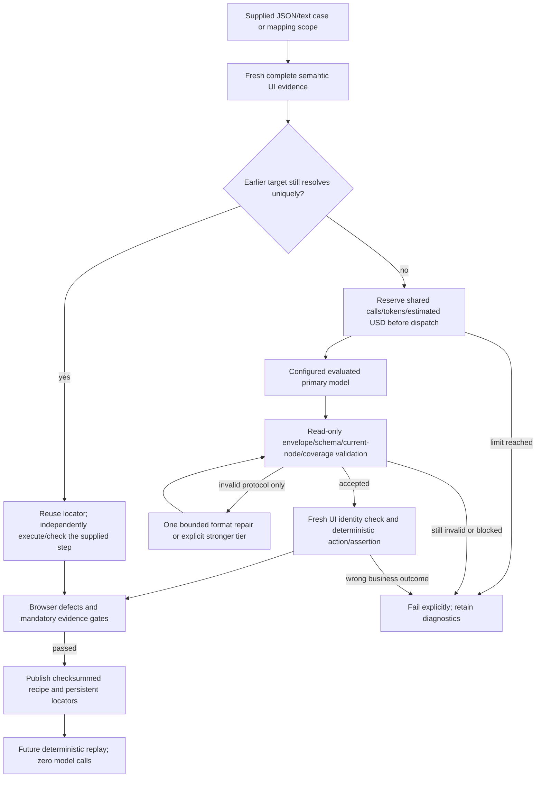

# Cost-conscious AI workflow with deterministic quality gates

[Documentation index](README.md) · [Project README](../README.md) · [Agent instructions](../AGENTS.md) · [Development guide](DEVELOPMENT.md)

All learned/discovered case IDs and CLI recipe filenames use `TST_`. Learning/replay execute through the default [Page Object Model](PAGE_OBJECT_MODEL.md), retaining fresh target resolution and independent case assertions. Saved page/control definitions require no generated Java compilation, and ordinary replay still constructs no model client.

The workflow is executable repository code, not a prompt-only recommendation. `AiWorkflowClient` is the default provider path for `plan-case`, `learn-case`, `discover-ui`, `map-ui`, JUnit AI agents and opt-in AI locator advice. Saved recipe replay, offline `validate-case` and deterministic suites construct no model client. All code, policy examples and guidance are part of this repository; no customer cases or credentials are bundled.

## Contents

- [Execution flow](#execution-flow)
- [Configure and run](#configure-and-run)
- [Savings that preserve the oracle](#savings-that-preserve-the-oracle)
- [Smaller requests, bounded batches and unchanged maps](#smaller-requests-bounded-batches-and-unchanged-maps)
- [Accounting and failure behavior](#accounting-and-failure-behavior)
- [Reports and engineer evaluation](#reports-and-engineer-evaluation)
- [Primary design references](#primary-design-references)

## Execution flow



The repair arrow is bounded in code: it does not form an unbounded agent loop. A read-only request gets at most one additional physical attempt. An evaluated escalation tier takes the place of the primary format repair when enabled and available; it is never an extra third attempt. An adaptive output-cap truncation gets one primary attempt with the full configured allowance instead of a stronger tier. A response already truncated at that full allowance fails immediately. Per-attempt counters and the shared physical-call/token/cost budget cover every attempt.

## Configure and run

Copy [ai-workflow.example.yaml](../ai-workflow.example.yaml) into a private target config, then supply its authorized org/session settings. The sample rates are **illustrative**. Replace them with reviewed prices for your selected provider, model and service tier. Select a primary model only after measuring quality on your app's controls. No model brand or current price is hardcoded into the workflow.

```powershell
java -jar sf-e2e-cli/target/sf-e2e.jar learn-case --config project.local.yaml --spec flow.local.json --params values.local.json --output .sf-e2e/cases/TST_flow-v1.local.json --locator-mode read-write
java -jar sf-e2e-cli/target/sf-e2e.jar replay-case --config project.local.yaml --file .sf-e2e/cases/TST_flow-v1.local.json --params values.local.json --strict-locators --locator-mode read-only
```

Use supplied JSON steps when intent is already structured: this avoids a text-planning model call. Text instructions remain supported and share the same budget with subsequent target learning. Mapping and autonomous route selection also share one workflow instance throughout the command, so moving to another scope/page does not reset its allowance.

For review before execution, `plan-case` translates text into an editable specification without a target session or UI engine. `CasePlanner` validates the same literal/reference/schema contract used by direct text learning. The separate plan command has its own bounded model workflow; a later `learn-case --spec` has a new learning budget and avoids repeating text translation. `validate-case` preflights the edited specification and runtime values offline, without a provider. Plans and offline validation establish intent/input validity, while learning establishes observed UI execution and caller assertions. See [the review sequence](CASE_WORKFLOWS.md#review-a-plan-before-executing).

Learning executes user-supplied actions. Plan appropriate unique/runtime data before replaying a mutating recipe. There is no automatic second execution of a completed business action merely to evaluate the model or retry a failure. The caller explicitly starts a later replay.

| Policy | Meaning |
| --- | --- |
| `agent.maxModelCalls` | Shared physical provider-attempt limit, including repair/escalation; reused responses consume no provider call |
| `agent.maxTokens` | Shared charged-token limit; known provider totals are used, while unavailable/failed-call usage keeps its reservation |
| `workflow.maxInputBytes` | Entire serialized wire request size; oversized evidence fails rather than silently truncating controls |
| `workflow.maxOutputTokens` | Maximum output allowance; adaptive requests normally use a smaller task-specific cap |
| `workflow.outputTokenParameter` | `max_completion_tokens` by default; explicit `max_tokens` for a compatible endpoint requiring that parameter |
| `workflow.reuseReadOnlyResponses` | Enable exact-evidence response reuse and fresh exact-target reuse within the current learning attempt |
| `workflow.compactRequests` | Default true: shorter discovery protocol, omit empty values/null target fields and transient timestamps; preserve all candidate identities, attributes, states and schemas |
| `workflow.adaptiveOutputLimits` | Default true: reserve/send a smaller task-specific output allowance, bounded by `maxOutputTokens` |
| `workflow.batchCaseTargets` | Default true: resolve multiple visible upcoming case targets in one read-only call; requires reuse enabled |
| `workflow.maxTargetsPerBatch` | Default 8; permitted range 2..16; only upcoming same-scope intents are grouped |
| `workflow.maxProtocolRetries` | Zero or one primary format-repair attempt for invalid read-only output |
| `workflow.maxEscalations` | Total stronger-tier attempts allowed in this workflow instance; default zero |
| `workflow.maxCostUsd` | Estimated spend ceiling using reviewed rates; zero disables the monetary gate while token/call caps remain active |
| `workflow.inputUsdPerMillionTokens`, `outputUsdPerMillionTokens` | Reviewed uncached input/output rates; both positive rates are required with a monetary ceiling |
| `workflow.escalation` | Explicit endpoint/model/credential reference and rates; credentials are resolved lazily only if escalation is needed |

JUnit creates one workflow per case context, shared across its personas. Its budgets are per case attempt. Aggregate reports sum the latest snapshot from each instance. They do not claim one global dollar cap across an arbitrarily large JUnit run. File learning/discovery/mapping has one workflow for the entire command. Existing action/deadline limits still apply independently.

## Savings that preserve the oracle

1. Semantic UI projection excludes input values and unnecessary business text before discovery.
2. A target already learned from the exact same instruction/scope/record reference is reused only after fresh strict resolution, permitted-role checks and unique identity matching. No repair/AI advice is allowed in this shortcut. Changed context or identity falls back to fresh learning; incomplete evidence fails.
3. Read-only response reuse requires an identical request/schema/params/route/node IDs/semantic controls/attributes/states. Only observation timestamps/revisions are excluded from the key. The in-memory cache is bounded to 256 entries and ends with the workflow instance. A new run does not reuse provider judgments.
4. Live `act`, `assert`, `wait` and `extract` calls are never cached or automatically escalated. An expected business value is never derived from a previous model answer or changed to make a check pass.
5. Independent deterministic assertions, fresh mapping checks, browser-defect gates and owned screenshot requirements remain mandatory before recipe publication.
6. Future replay uses persisted recipes/locators without a provider; deterministic self-healing remains independent of AI.

Discovery validation covers the closed JSON schema, referenced current nodes, complete mapping coverage, unique/reserved keys and candidate-only navigation routes. Caller-level checks additionally enforce intent, parameter literals, fresh UI identity, ambiguity and expected business outcomes. A cheaper answer cannot bypass those checks.

## Smaller requests, bounded batches and unchanged maps

The default adapter compacts **read-only discovery** requests. It preserves every projected node and its current ID, semantic identity, attributes, disabled/checked state, coverage flags, supplied params and complete schema. Nonempty evidence is preserved. Empty discovery values, null identity fields, observation timestamps/revisions and an empty ledger add no targeting evidence and are omitted. Live action/assertion/wait/extraction requests keep their original protocol and evidence.

| Request | Adaptive output allowance before the configured ceiling |
| --- | ---: |
| Single `case-target` or `heal` | 768 |
| `case-target-batch` | `max(768, 512 + 128 * intentCount)`; 3 targets use 896 |
| `map` | `max(768, 512 + 80 * candidateCount)` |
| `discover-routes` | 1024 |
| Text planning or live agent judgment | Full configured allowance |

Output allowances include visible and reasoning tokens on compatible models. A low cap can increase truncation for a reasoning-heavy model. Evaluate the selected model against fixed cases; use `adaptiveOutputLimits: false` when its evaluated output needs the full allowance. The adapter recognizes `finish_reason: length` and performs the single bounded full-allowance repair described above, if enabled and affordable. These limits constrain reservations and possible output; they do not promise an equal reduction in actual billed tokens. See the [official output parameter reference](https://developers.openai.com/api/reference/resources/chat/subresources/completions/methods/create).

For structured or text-planned cases, the learner groups upcoming unique intents in the same scope and submits their complete candidate union. It stops grouping at navigation, another scope, record-name binding, count or absence checks. Ambiguous/absent/future controls may be returned as null; they are resolved from their actual later UI. A batch that cannot fit the current byte/token/estimated-cost reservation is deferred before provider dispatch; single-target discovery proceeds without discarding evidence or consuming a batch call.

Batch answers are temporary semantic descriptors, not durable future locators. Before every later step, a fresh complete observation must match the full scope's route, ordered semantic identities, attributes and disabled/checked states. Node IDs are never carried between observations. A changed UI invalidates the remaining batch. The descriptor must rematch exactly one fresh role-compatible node, then undergo the normal fresh mapping/action/assertion checks. Input values do not invalidate the context, so filling one unchanged form field does not force another paid call. No later business action is executed early.

`map-ui` can reuse an existing complete map when every eligible control matches exactly and uniquely in both directions, the route/engine agree, record-link templates agree, and a second complete observation confirms unchanged context. It sends no provider request and does not rewrite the map. A changed control falls back to ordinary mapping; incomplete evidence fails. The default AI command still validates its configured provider credentials at initialization, even when this mapping shortcut makes zero calls.

All optimizations are enabled by default, including for older Java configuration constructors. For a controlled comparison, keep intent, expected outcomes, model and rates fixed; set `compactRequests`, `adaptiveOutputLimits` and `batchCaseTargets` to false for the baseline. Each switch can also be disabled independently. Direct custom `ModelClient` implementations retain single-target learning unless wrapped in `AiWorkflowClient`.

## Accounting and failure behavior

Before dispatch, the workflow reserves input tokens using serialized UTF-8 request bytes plus framing headroom, together with the actual task-specific output cap. This is a deliberately conservative **estimate**, not the provider's tokenizer. It can reject a large request that would fit a provider tokenizer. Reduce the scope or review the configured limits; the workflow does not drop UI evidence to fit.

When valid provider input/output usage is available, the reservation is settled using those counts and configured rates. With only total usage, the higher configured input/output rate provides a conservative cost estimate. Missing usage, invalid transport/protocol responses and failed requests keep their reservations; they never become free calls. Provider usage that exceeds its reservation/output cap, inconsistent accounting or exhausted budgets stops further model dispatch.

Without configured prices, `estimatedCostUsd` is `null` for an AI workflow; this means unknown, not free. Token/call limits still work. Prices, cached-token discounts, taxes, service charges, external subscription accounting and provider-side behavior can differ. The workflow's estimate is not an invoice or a guaranteed provider billing cap. Configure the provider's own spending controls too when an actual billing ceiling is required. Compatible endpoints/adapters must honor the configured output-token parameter.

The optional subscription launcher now forwards the configured modern/compatibility output allowance to its provider call. Its default for an older request lacking an allowance is 4096. Malformed/ambiguous limits fail before dispatch. Three credential-free Node boundary checks cover the helper; a new live subscribed-provider trial is not claimed. See [efficiency assessment](EFFICIENCY.md) for the audit that exposed the previous fixed 16000 allowance.

Protocol repair/escalation is limited to `map`, `heal`, `case-target`, `case-target-batch`, `case-plan` and `discover-routes`, where no business action has been dispatched. It does not retry rate-limit/authentication/transport failures, a valid `FAILED`/`BLOCKED` response or a failing deterministic assertion. If the bounded quality attempt fails, `AI_WORKFLOW_REJECTED` stops the caller's older format-retry loop too.

| Code | Next action |
| --- | --- |
| `AI_BUDGET_EXHAUSTED` | Inspect consumption/reservations; review scope or explicit allowance before another run |
| `AI_CONTEXT_LIMIT` | Narrow the UI scope or supplied intent; evidence was not truncated |
| `AI_USAGE_INVALID` | Investigate provider accounting/adapter compatibility; the instance is stopped |
| `AI_WORKFLOW_REJECTED` | Refine intent/scope or evaluate another configured model; expectations remain unchanged |

## Reports and engineer evaluation

Allure's redacted event log and quality attachment include provider attempts, reuse, escalation and workflow snapshots. `quality-summary.json` contains `aiWorkflow`: physical provider calls, reused responses/targets, charged tokens, unknown-usage calls, configured-rate status, estimated USD and stopped status. Aggregate metrics retain only the last snapshot per workflow ID before summing, so per-call snapshots cannot inflate the totals. Events contain metadata, not prompts, UI node payloads, credentials or response contents.

Additional metrics are `inputBytesSent` (serialized wire size for dispatched attempts), `compactBytesSaved` (difference from the full discovery payload at the same allowance), `outputTokensReserved` (sum of actual per-attempt output caps), `batchedRequests`, `batchedTargetsReused` and `reusedScopes`. Byte savings are not measured provider tokens, and reserved output is not actual output usage. Existing older reports aggregate with zero for absent additional fields.

Run the internal checks before changing a model/policy:

```powershell
.\mvnw.cmd -B -ntp verify -Pchecks
node scripts/check-project-language.mjs
```

`AiWorkflowClientTest` exercises bounded attempts, read-only reuse/invalidation, uncached live judgments, before-dispatch cost/context rejection, paid escalation, unknown/failed usage and accounting violations. `ModelProtocolTest` verifies the real HTTP request cap and provider-owned input/output counts. `AiCostReportingTest` proves aggregation avoids duplicate snapshots and preserves unknown cost.

`UiMapperTest` also proves a valid blocked discovery returns `MAPPING_BLOCKED` after one paid attempt, without entering the caller's format-repair loop. The existing [Windows/Linux checks workflow](../.github/workflows/checks.yml) runs these internal regressions on pushes and pull requests without model credentials or provider charges; local verification does not claim a hosted CI result.

`AiWorkflowHarnessIT` compares the same isolated browser case with target reuse disabled/enabled: two learning calls become one, both verify the same explicit result, and a fresh saved-recipe replay uses no provider. A wrong expected value still fails. This **50% reduction applies to that fixture**, not a promised saving for every Salesforce application or a model-quality benchmark.

`BatchLearningHarnessIT` uses actual local HTTP transport and Chromium to compare three distinct field targets: 3 discovery calls become 1, serialized input falls by more than half, and the same supplied expected value is verified. Fresh saved replay uses no provider and rejects a wrong expectation. UI drift invalidates the batch; invented node IDs fail before locator storage or business actions. HTTP usage is synthetic and rates are illustrative. `AiRequestEfficiencyTest` verifies compact evidence, reservation metadata, bounded full-output repair and non-consuming optional preflight. `UiMapperTest` verifies unchanged-scope reuse and re-mapping a changed control. The public [benchmark helper](../scripts/MeasureFrameworkEfficiency.java) records paired three-target samples in `aiCostComparison` alongside its replay/healing/report measurements.

For your target, maintain a private evaluation set with representative controls, dialogs, duplicate names, permissions, locales and known defects. Compare primary-only and bounded-escalation policies on first-pass valid output, verified case completion, defect rejection, paid calls/tokens/USD and latency. Select the least costly configuration meeting your acceptance threshold. Keep cases and supplied expectations fixed during comparison, preserve failed reports, and rerun evaluation when the model, protocol or application changes. The repository ships internal synthetic checks, not an org-specific evaluation suite.

## Primary design references

The workflow adapts request/token reduction and measured model selection from [official OpenAI cost guidance](https://developers.openai.com/api/docs/guides/cost-optimization), output caps and usage fields from the [Chat Completions reference](https://developers.openai.com/api/reference/resources/chat/subresources/completions/methods/create), and task-specific regression evaluation from [evaluation best practices](https://developers.openai.com/api/docs/guides/evaluation-best-practices). It remains a configurable compatible-endpoint adapter; these sources do not establish a price or quality claim for your chosen model.
