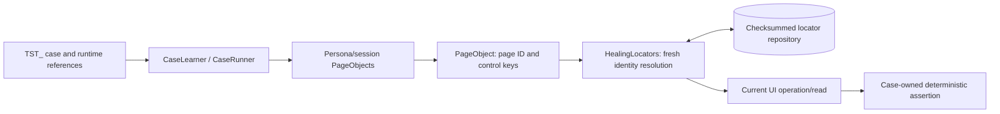

# Default Page Object Model and TST_ names

[Documentation index](README.md) · [Project README](../README.md) · [Agent instructions](../AGENTS.md) · [Development guide](DEVELOPMENT.md)

Page Object Model (POM) is the default execution architecture for supplied-case learning, autonomous discovery and saved-recipe replay. There is no opt-in flag. Java consumers use `SfTestContext.page(id)`/`pages()` and can compose typed project-owned page/component APIs over them. The consumer test module remains empty.

## Contents

- [Architecture and persistence](#architecture-and-persistence)
- [Java page composition](#java-page-composition)
- [Naming policy](#naming-policy)
- [Further efficiency opportunities](#further-efficiency-opportunities)

## Architecture and persistence



`PageObjects` reuses Java wrappers for each page ID within one session/persona/worker. `PageObject` encapsulates named control operations and reads; `CaseRunner` retains the assertion oracle and its polling deadline. It handles navigation separately, then routes every targeted operation through the same page API during learning and replay. CLI reports record `executionModel: page-object-model` and the referenced page/control inventory. Replay-plan events carry the same inventory.

Page objects never cache DOM nodes, observations, field values or business expectations. Every operation delegates to fresh identity resolution, preserving route/frame checks, ambiguity refusal, complete-observation requirements, bounded pre-dispatch retries and confident repair/history persistence. An uncertain dispatched action is never repeated. Workers cannot share page objects across threads, and each persona has a separate registry. Browser contexts remain isolated.

New control identities use `page.<route-context hash>.<learning revision>` identifiers, grouping controls first recorded on the same route into one model. Already defined controls retain their existing page/key across cases after fresh independent identity checks, without duplication or locator rewriting. A new learning revision for new/changed identities prevents a failed attempt from replacing the controls referenced by an older recipe. A case can compose existing models and newly learned models. Route changes produce separate contexts; this is route-level grouping, not automatic classification of every Salesforce modal or business component. Dialog/frame ownership remains in each locator's semantic scope and attributes.

The existing recipe `page`/`key` references and persisted locator entries are the page definitions. `CaseRecipe.pageObjects()` exposes their grouped inventory. There is no duplicate selector repository or generated Java source that must be compiled after discovery. Learning automatically searches existing definitions using exact semantic identifiers or previously validated instruction associations, followed by complete fresh identity checks. The optional hashed association sidecar contains references only. Unproven semantic equivalence is never guessed to skip AI discovery. Java consumers and reviewed recipes can also reference existing page/control keys directly. Historical schema-1 recipes retain their original IDs, fields and checksum and execute through POM without migration.

## Java page composition

This example is a consumer-side API pattern, not a shipped Salesforce business case. The installation supplies the mapped page and control keys; `referenceKey` and `statusKey` need to identify controls in that page model. Named business operations can compose multiple page objects when the workflow crosses routes.

```java
import hu.ak91.sf.e2e.core.page.PageObject;
import hu.ak91.sf.e2e.junit.SfTestContext;

final class ReferencePage {
    private final PageObject page;
    private final String referenceKey;
    private final String statusKey;
    ReferencePage(PageObject page, String referenceKey, String statusKey) {
        this.page = page;
        this.referenceKey = referenceKey;
        this.statusKey = statusKey;
    }
    void enterReference(String reference) { page.fill(referenceKey, reference); }
    String reference() { return page.read(referenceKey).value(); }
    String status() { return page.read(statusKey).text(); }
}
```

The case supplies its expected result independently:

```java
sf.pages().open(runtimeRoute);
var form = new ReferencePage(sf.page(pageId), referenceKey, statusKey);
form.enterReference(inputReference);
sf.expect("The reference equals the supplied expectation",
    () -> java.util.Objects.equals(expectedReference, form.reference()));
```

Use `page.click(key)`, `fill(key,value)`, `select(key,label)` or `check(key,boolean)` for common interactions. `page.action(key,kind,value,bindings)` supports the same reviewed file/dialog/widget operation kinds and runtime record-name binding as recipes. Invalid structured operation parameters are rejected before observing/dispatching. `page.read(key)` returns the current node for independent assertions; specialized count/absence logic remains available through `sf.locators()` and recipe assertions. Keep predicates read-only and keep expected values outside the page model.

The low-level `sf.locators()` API remains available for compatibility and specialized diagnostics. Prefer page composition for new cases. Authentication, fixtures, evidence and teardown continue to belong to framework lifecycle.

## Naming policy

| Input | Newly generated result |
| --- | --- |
| Structured spec `id: my-flow` | `TST_my-flow` |
| Text/discovery `--id my-flow` | `TST_my-flow` |
| Existing `--id TST_my-flow` | `TST_my-flow`, no duplicate prefix |
| CLI `--output cases/flow-v1.local.json` | `cases/TST_flow-v1.local.json` |
| Extracted literal parameter file | `cases/TST_flow-v1.local.json.params.local.json` |
| Historical recipe `id: old-flow` | Preserved on load/replay |

Case IDs allow letters, digits, underscore, dot and hyphen, at most 70 characters including `TST_`, with a nonempty suffix. Unprefixed input can contain at most 66 characters. Only the exact uppercase `TST_` counts as the prefix. IDs are normalized before a planning call or browser action. New CLI recipe filenames are normalized in the requested directory before authentication; both original and normalized existing files are protected. The CLI prints the actual saved paths. Update consumer suite entries to those paths; the framework does not silently edit external manifests.

For new handwritten Java cases, use a `TST_` class/method and matching `@SfCase(id="TST_...", name="TST_...")`. A class can be named `TST_ReferenceIT` to retain the normal live-case exclusion convention. Handwritten annotation IDs/names are still explicit consumer choices; existing Java cases are not rewritten automatically. Recipe names and Allure case identity use the generated `TST_` ID; dataset labels are separate and need not use this prefix.

## Further efficiency opportunities

Prioritize representative measurements rather than assuming a design pattern reduces elapsed time. Official [Playwright POM guidance](https://playwright.dev/java/docs/pom) supports encapsulation/reuse; [locator guidance](https://playwright.dev/java/docs/locators) explains fresh resolution and resilient semantic targeting. The recommendations below apply those practices to this framework; their target-specific benefit is an inference, not a new benchmark.

| Priority | Action | Framework status / quality constraint |
| --- | --- | --- |
| 1 | Use saved `TST_` recipes for routine regression | Implemented: zero framework model calls during replay; retain wrong-expectation checks |
| 2 | Reuse browser processes with fresh contexts | Implemented: scoped worker runtime; earlier local two-case measurement was 41.4% shorter, excluding org auth/network/reporting |
| 3 | Run independent datasets concurrently and select relevant tags | Implemented: 1..8 workers, resource/dependency/identity locks; overlapping identities serialize safely |
| 4 | Prefer authorized API setup/backend oracles where the UI is not the subject | Implemented REST/owned fixtures; maintain metadata, permissions, uncertain-write and API-budget checks |
| 5 | Compose shared page/component methods for repeated business intent | Default POM implemented; consumer owns named operations and assertions; no shared DOM cache |
| 6 | Measure representative phase p50/p95, locator retries and AI calls | Implemented: automatic context-separated retained-run dashboard, unknown-cost gaps and failed-outcome visibility |
| 7 | Select regression cases from changed metadata/components | Implemented: reviewed consumer coverage mapping, dependency closure and full-suite fallback for unknown/global changes |
| 8 | Automate a reviewed locator-maintenance lane | Existing read-write healing plus strict restart can be orchestrated; automatic scheduled drift triage/baseline approval is future work |

Use the existing external-layer runner to keep component checks out of the slow browser path when appropriate. Salesforce's [LWC testing guide](https://developer.salesforce.com/docs/platform/lwc/guide/testing.html) explains that Jest component checks run without a browser or org connection; the [E2E guidance](https://developer.salesforce.com/docs/platform/lwc/guide/testing-dom-api.html) distinguishes component tests from complete UI flows. Consumer-owned LWC/Jest, Apex/API and E2E assertions should complement each other and retain separate provenance/verdicts in the combined Allure report. This framework supplies orchestration/import adapters; it does not invent the consumer's component tests.

The concrete `run-components` adapter now probes and executes the installed, exactly pinned Salesforce LWC/Jest package with explicit test files. Native `componentPlan` release entries integrate its results without another Allure render. See [efficiency workflows](EFFICIENCY_WORKFLOWS.md) for all three implemented developments, input contracts and failure policies.

Keep default masked screenshots and Allure evidence. Avoid reducing retry deadlines without observed readiness distributions, caching mutable observations, repeating dispatched writes or sharing authenticated contexts merely to improve a time figure. See [efficiency](EFFICIENCY.md), [case workflows](CASE_WORKFLOWS.md) and [verification](VERIFICATION.md).
