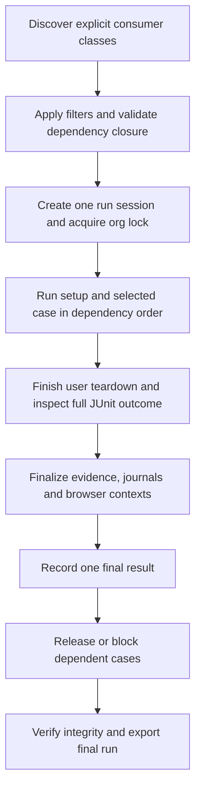

# Test structure and execution review

Reviewed and corrected on October 5, 2026. All four findings below have been addressed. No consumer business cases were added. Original audit evidence is retained below as historical context; current verification is recorded in [VERIFICATION.md](VERIFICATION.md).

## Implemented corrections

| Finding | Corrected behavior | Regression evidence |
| --- | --- | --- |
| Premature finalization and ignored teardown errors | `SfE2eExtension` finalizes after user `@AfterEach`; the coordinator reconciles failed/aborted callbacks and class/container failures before dependents proceed | `ExecutionLifecycleTest`: open engine during teardown, teardown failure, late callback failure/abort, class setup/teardown failure |
| Direct-JUnit dependency bypass | `SfE2eExtension.beforeAll` fails without a coordinated session, before user `@BeforeAll`; all consumer runs use the same profile/dependency/lock contract | Direct launcher regression checks no user fixture/body runs and an explicit `CONFIG_INVALID` error is reported |
| Repeated class fixtures | Selected methods are grouped into one Jupiter execution per class and ordered by `DependencyMethodOrderer` | Successful shared setup/two children, one class setup/teardown, retained `PER_CLASS` instance and per-case context closure |
| Forbidden profile dependencies | The planner validates no-model exclusions across the full dependency closure | Both deterministic/regression profiles reject an AI setup during planning |

Use the CLI or `RunCoordinator` from an IDE run configuration. Independent and dependent Salesforce cases alike require coordination; raw JUnit launches are deliberately rejected. The user test module remains empty.

Cross-class dependencies must permit contiguous class execution. The planner rejects A -> B -> A class interleaving and conflicting `@TestMethodOrder` annotations. Group related cases into one class or restructure their setup dependencies. This is an explicit validation rule, not silent repetition of class fixtures.

The new lifecycle regressions use the actual coordinator and extension with a package-private engine/context factory, valid PNG evidence and isolated journals. No Salesforce authentication/model is used. Report integrity additionally distinguishes a disabled unstarted case from a started attempt that must retain its journal.

Verification of the four corrections: **118 checks in 17 suites**, zero failures/errors/skips, successful shaded CLI build. Subsequent recipe/Allure/timestamp work raised the inventory to 150 checks; browser quality gates, stronger assertions, dataset suites and completion-audit regressions now bring it to **176 checks in 29 suites**. See [current verification](VERIFICATION.md). The consumer workspace/default CLI case list remain empty.

## Original assessment (before correction)

The framework checks have a coherent dependency-based layering and the consumer workspace is empty. The user-case execution lifecycle has important gaps. A passing check inventory does not establish correct teardown, class-level lifecycle or direct-JUnit dependency behavior.

The last full Maven verification passed 103 checks in 16 suites with zero failures/errors/skips. This review reused that recorded inventory and ran additional targeted probes; it did not rerun the unchanged full build.

| Layer/module | Checks | Purpose |
| --- | ---: | --- |
| Core | 29 | Configuration, contracts, storage state, locator persistence and resolution policies |
| Agent component checks | 26 | Mapping validation, HTTP model protocol, constrained agent and replay |
| Salesforce | 11 | Authentication, credential redaction and permanent journals |
| Reporting | 7 | Evidence integrity and exporters |
| JUnit | 3 | Basic selection and failed-setup propagation |
| CLI | 4 | Empty selection, readiness and generic inputs |
| Chromium engine harnesses | 22 | Real DOM actions, scopes/frames, masked evidence and healing policies |
| Mapping lifecycle harness | 1 | Protocol mapping, offline execution, label drift, persistent repair and restart |
| Consumer business cases | 0 | Intentionally empty |

Surefire runs 80 unit/component checks in the `test` phase. Failsafe runs the 23 Chromium harness checks through the `integration-test`/`verify` phases. The `sf-e2e-tests` module has no Failsafe binding; future `IT` classes run through the explicit CLI, as documented, while `*Test` classes would be selected by Surefire.

## Original findings, in priority order (resolved)

### 1. High: final result and context closure happen before user teardown

[`SfE2eExtension`](../sf-e2e-junit/src/main/java/hu/ak91/sf/e2e/junit/SfE2eExtension.java), line 26, calls `sf.finish()` and accepts the result inside `interceptTestMethod`. `SfTestContext.finish()` closes browser contexts. JUnit subsequently runs the consumer's `@AfterEach` methods. The extension's `afterEach`, line 34, ignores their exception when a result already exists.

[`RunCoordinator`](../sf-e2e-junit/src/main/java/hu/ak91/sf/e2e/junit/RunCoordinator.java), lines 37–42, creates a summary listener but never examines its recorded failures. Therefore a teardown failure can coexist with a framework `PASSED` result and allow dependent cases to run. A consumer teardown also receives an already closed browser context.

The targeted JUnit probe reproduced the order: test body passed → interceptor finalized → user teardown threw → callback saw the exception → JUnit reported one failure. The framework suppression follows directly from the result-exists guard and unused summary; the probe did not perform live org authentication.

Required correction: finalize evidence, verdict and contexts after user teardown, and reconcile the complete JUnit outcome, including container failures, before releasing dependents.

### 2. Medium: direct JUnit execution bypasses dependency scheduling

`SfE2eExtension.beforeEach`, lines 14–16, creates a one-case standalone session when `RunCoordinator` is absent. It never discovers, orders or verifies `@SfCase.dependencies`. The local org lock and coordinator's case-selection/profile checks also apply only to the coordinator path.

Consequently, an IDE/JUnit launch does not have the dependency guarantees of the CLI. Arbitrary JUnit ordering can run a dependent before its required setup, despite the annotation. Direct execution with shared dependencies needs either the same orchestration contract or an explicit fail-fast restriction to independent cases.

### 3. Medium: per-method launches repeat class-level fixtures

`RunCoordinator`, lines 38–40, executes a new JUnit discovery request for each selected method. Class lifecycle is consequently scoped to each request, rather than the logical selected class. `@BeforeAll`/`@AfterAll` repeat for each selected method, and `@TestInstance(PER_CLASS)` does not preserve one instance across the coordinator's separate executions.

A two-method JUnit probe using the same launcher reproduced two `@BeforeAll` calls. Preserve normal class lifecycle, or explicitly define and enforce a per-case fixture contract; do not silently imply standard class-scoped JUnit behavior.

### 4. Medium: dependency expansion can cross the selected profile

[`SelectionPlanner`](../sf-e2e-junit/src/main/java/hu/ak91/sf/e2e/junit/SelectionPlanner.java), lines 36–46, applies the profile filter to initial cases, then recursively adds dependencies without rechecking the profile. A deterministic case depending on an `ai` case produces `[SETUP-AI, CASE-DETERMINISTIC]`.

The probe reproduced this plan. The coordinator correctly rejects it later, before execution, so this is not an AI-call leak through the deterministic CLI. It is an inconsistent selection contract: `list` can show a plan that `run` refuses. Report an explicit forbidden-dependency error during planning. Tag and exact-case filters may intentionally expand to required setups; the no-model profile boundary must remain explicit.

## Original coverage gaps

The three existing JUnit checks cover empty/basic profile selection and an authentication failure followed by a blocked dependent. They do not verify:

- Successful setup and dependent execution with one final result per case.
- Failing user teardown, failing class teardown, and accurate report/exit-code propagation.
- Successful shared setup deduplication in actual execution, multi-level dependencies and cycles.
- Direct-JUnit dependency semantics and consistent profile checks through dependencies.
- Normal class-level fixture semantics and deliberately disabled cases.

The pure planner probe did confirm stable shared setup ordering and deduplication: `[SHARED, CHILD-A, CHILD-B]`. That is positive planner evidence, not a successful JUnit lifecycle test.

`CoreContractsTest` combines several independent subjects, including configuration, numeric parsing, deadlines, secrets and schema validation. Splitting by responsibility would improve navigation and failure diagnosis, but this is a maintainability observation rather than a correctness defect.

## Current execution contract



The implementation preserves class-level lifecycle within contiguous class groups and explicitly rejects incompatible graphs. Locator retries belong inside a case's resolution process and remain separate from whole-case/business-action retries. The existing zero whole-case retry policy avoids automatically repeating potentially committed mutations.

Credential-free regression command:

```powershell
.\mvnw.cmd -B -ntp -pl sf-e2e-junit -am test
```

Original evidence: `.tools/logical-suite-audit.log` and `.tools/requirements-audit-summary.json`. Current fix evidence: `.tools/junit-lifecycle-fixes.log` and `.tools/four-fixes-final-checks.log`. Framework regression fixtures are not additions to the consumer business suite.
